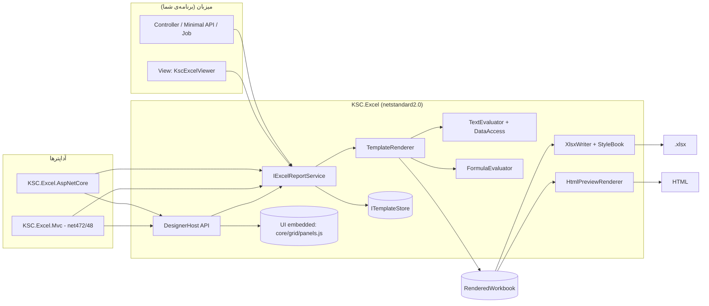

<div dir="rtl">

# KSC.Excel — سند طراحی

این سند «چرا و چگونه» ساخته شدن محصول را شرح می‌دهد: هدف‌ها، تصمیمات معماری، مدل قالب، الگوریتم رندر، فایل خروجی، طراح، امنیت، کارایی، تست و نقشه‌ی راه. راهنمای استفاده: [KSC.Excel.md](KSC.Excel.md).

## ۱) هدف و دامنه

**مسئله.** تولید فایل Excel زیبا در برنامه‌های سازمانی معمولاً یعنی: انتخاب یک کتابخانه (EPPlus/ClosedXML/NPOI/OpenXML SDK)، نوشتن ده‌ها خط کد قالب‌بندی برای هر گزارش، و تکرار آن با هر تغییر ظاهری. تغییر رنگ یا ستون = Build و Deploy.

**هدف.**

1. **طراح تصویری** (شبیه Stimulsoft) که غیربرنامه‌نویس هم بتواند با آن قالب زیبا بسازد؛ پیچیدگی استفاده کم.
2. برنامه‌نویس **هیچ کتابخانه‌ی Excel را مستقیم لمس نکند**؛ فقط `قالب + داده → xlsx`.
3. اجرا روی **.NET (8/10)** و **.NET Framework**.
4. **نمایش در صفحه** (ViewComponent / Html helper)، و در غیر آن **دانلود**.
5. به‌عنوان **محصول**: مستند کامل، تست خودکار، نسخه‌بندی قالب، امنیت پیش‌فرض، بدون وابستگی خارجی سنگین.

**خارج از دامنه (v1).** نمودار، PivotTable، ماکرو، جدول‌های ListObject، کامنت، خواندن/ویرایش xlsx موجود، رمزگذاری، ویرایش هم‌زمان چندنفره. (نقشه‌ی راه: §۱۶)

## ۲) اصول طراحی

| اصل | معنی در عمل |
|---|---|
| **قالب = داده** | قالب یک JSON ساده است؛ قابل ذخیره در Git/DB، قابل diff، قابل تولید با کد |
| **یک موتور، دو میزبان** | منطق در هسته‌ی `netstandard2.0`؛ آداپتر ASP.NET Core و MVC 5 فقط «چسب» هستند |
| **بدون وابستگی به کتابخانه‌ی Excel** | نویسنده‌ی OOXML اختصاصی (`System.IO.Compression` + `System.Xml`) |
| **WYSIWYG تا حد ممکن** | طراح همان مدلی را ویرایش می‌کند که موتور رندر می‌کند؛ پیش‌نمایش از همان موتور می‌آید |
| **امن به‌صورت پیش‌فرض** | طراح خارج از Development بدون لاگین باز نمی‌شود؛ داده هرگز فرمول نمی‌شود؛ نام قالب اعتبارسنجی می‌شود |
| **بدون CDN** | UI به‌صورت منبع Embedded در Assembly است (مناسب شبکه‌ی داخلی) |
| **خطا قابل فهم** | هشدارهای قالب (نوار نامعتبر، توکن ناشناخته) به‌جای خرابی خاموش |

## ۳) تصمیمات معماری (ADR)

| # | تصمیم | جایگزین‌های بررسی‌شده | دلیل |
|---|---|---|---|
| A1 | هسته `netstandard2.0` | چند-Target (`net462;net8;net10`) | یک باینری برای همه‌ی پلتفرم‌ها؛ API لازم (Zip, Xml, Reflection, Expression) در آن هست. روی net48 هم تست می‌شود |
| A2 | **نویسنده‌ی XLSX اختصاصی** | ClosedXML، EPPlus (مجوز تجاری)، NPOI، OpenXML SDK | صفر وابستگی/مجوز؛ کنترل کامل بر حافظه و سرعت؛ فقط زیرمجموعه‌ی لازم (≈۱۰۰۰ خط)؛ هزینه: خودمان باید سازگاری با Excel را تضمین کنیم (→ §۸ و §۱۴) |
| A3 | قالب JSON | قالب `.xlsx` با placeholder | قالب xlsx نوار تکرار/نوع/فرمول‌توکن/طراحی تصویری مستقل از Excel نمی‌دهد و روی سرور نیاز به parse xlsx دارد |
| A4 | **نوار تکرار (Band)** روی سطرها | محدوده‌ی نام‌دار / جدول | مدل ساده و قابل‌فهم برای کاربر (مثل Stimulsoft)؛ تو در تو شدن طبیعی؛ نگاشت به آدرس‌های نهایی آسان |
| A5 | فرمول‌ها **زنده** و با توکن `[Band.Field]` | مقدار محاسبه‌شده ثابت | کاربر خروجی را ویرایش می‌کند و جمع‌ها باید به‌روز بمانند |
| A6 | مقدار ذخیره‌شده‌ی فرمول (cached) با یک ارزیاب کوچک | فقط `fullCalcOnLoad` | نمایشگرهایی که محاسبه نمی‌کنند (موبایل، Quick Look، pandas) صفر نشان نمی‌دهند؛ پیش‌نمایش HTML هم از همین استفاده می‌کند |
| A7 | `Newtonsoft.Json` برای قالب | `System.Text.Json` | در .NET Framework بدون مشکل Binding Redirect؛ در همه‌ی پروژه‌های KSC هست |
| A8 | UI طراح: **Vanilla JS** بدون Build (core/grid/panels) | React/Vue، Blazor | بدون زنجیره‌ی Node، قابل Embed، سبک، بدون CDN |
| A9 | نمایش در صفحه = **HTML از همان موتور** | جاسازی Excel Online/SheetJS | بدون وابستگی؛ ظاهر کنترل‌شده؛ ViewComponent ساده |
| A10 | `DesignerHost` **بی‌طرف نسبت به فریم‌ورک** (Request/Response ساده) | کنترلر MVC در هسته | همان کد روی ASP.NET Core و System.Web اجرا می‌شود |
| A11 | ذخیره‌سازی پشت `ITemplateStore` (پیش‌فرض فایل JSON) | فقط DB | ساده‌ترین شروع؛ جایگزینی برای DB/Blob |
| A12 | لینک دانلود Viewer با **توکن تصادفی در حافظه** | ارسال داده به کلاینت | داده‌ی گزارش (ممکن است حساس باشد) به مرورگر برای رندر دوباره نمی‌رود؛ توکن به کاربر بسته می‌شود |

## ۴) معماری



### لایه‌ها

| لایه | مسئولیت | فایل‌های اصلی |
|---|---|---|
| **Model** | قالب (`ExcelTemplate`, `SheetTemplate`, `CellDef`, `BandDef`, `StyleDef`, …)، `TemplateBuilder` | `Model/` |
| **Engine** | دسترسی به داده، ارزیابی `{{…}}`، رندر (Band/ادغام/توکن)، ارزیاب فرمول، مدل رندرشده | `Engine/` |
| **Writer** | OOXML: parts، styles، sharedStrings، drawing | `Writer/` |
| **Preview** | HTML برای نمایش در صفحه و طراح، فرمت‌کننده‌ی عدد | `Preview/` |
| **Services** | `IExcelReportService`، Options، Storeها، مدل‌های ثبت‌شده، `DownloadStore` | `Services/` |
| **Designer** | `DesignerHost` (API+UI) و منابع UI | `Designer/` |
| **Adapters** | اتصال به ASP.NET Core / System.Web | `KSC.Excel.AspNetCore`, `KSC.Excel.Mvc` |

### جریان رندر

```
قالب (JSON)  +  داده (POCO/Dict/JSON/DataTable)
      │
      ▼  TemplateRenderer.Render                         (برای هر برگه، RepeatFor را باز می‌کند)
  Prepare:  سلول‌ها به‌ازای سطر، ادغام‌ها به‌ازای سطر شروع، درخت نوارها (والد = کوچک‌ترین نوار شامل)
  EmitRange(1..آخرین سطر):  برای هر سطر  → یا EmitBand (تکرار) یا EmitRow
  ResolveFormulas:  توکن‌های [..] → آدرس واقعی
  MapDecorations:  قالب شرطی/اعتبارسنجی/فیلتر/فریز/تصویر/چاپ ← نگاشت سطر قالب به سطر نهایی
  Cached values:  FormulaEvaluator
      │
      ▼  RenderedWorkbook ──► XlsxWriter ──► .xlsx
                         └──► HtmlPreviewRenderer ──► HTML
```

## ۵) مدل قالب (شِمای JSON — نسخه‌ی ۱)

مختصات: ردیف و ستون **۱-مبنا** (`r`, `c`). ادغام‌ها و محدوده‌ها به‌صورت A1 (`"A1:C3"`). نام‌های JSON camelCase است. مقادیر `null` نوشته نمی‌شوند؛ مقادیر پیش‌فرض‌ِ غیرصفر (مثل `showGridLines:true`) همیشه نوشته می‌شوند تا بازخوانی معنا را عوض نکند.

### `ExcelTemplate`

| فیلد | نوع | توضیح |
|---|---|---|
| `schemaVersion` | int | ۱. نسخه‌ی بالاتر از کتابخانه رد می‌شود (`InvalidDataException`) |
| `name`, `title`, `description`, `author` | string | `name` کلید ذخیره‌سازی |
| `modelName` | string? | نام مدل ثبت‌شده برای فهرست فیلد |
| `defaultFont`, `defaultFontSize` | string, double | فونت پایه (`Tahoma`, ۱۰) |
| `sheets` | `SheetTemplate[]` | برگه‌ها |
| `styles` | `{id → StyleDef}` | جدول سبک‌ها؛ سلول با `s` ارجاع می‌دهد |
| `sampleData` | JSON | فقط برای پیش‌نمایش طراح |

### `SheetTemplate`

| فیلد | توضیح |
|---|---|
| `name`, `repeatFor` | نام (می‌تواند `{{}}` داشته باشد) و مسیر لیست برای تکرار برگه |
| `rtl`, `showGridLines`, `tabColor`, `zoom` | نمایش |
| `defaultColWidth`, `defaultRowHeight` | ۱۲ نویسه، ۱۸ پوینت |
| `columns[]` `{index,width,hidden}` · `rows[]` `{index,height,hidden}` | ابعاد |
| `cells[]` `{r,c,v,s,t,l}` | `v` مقدار/`{{…}}`/`=فرمول`؛ `s` شناسه‌ی سبک؛ `t`=`text` اجبار متن؛ `l` لینک |
| `merges[]` | `"A1:C1"` |
| `bands[]` `{name,source,firstRow,lastRow,keepWhenEmpty,alternateFill}` | نوارهای تکرار |
| `freezeRows`, `freezeCols`, `autoFilter`, `protect` | ساختار |
| `conditionalFormats[]` | `{range,type,operator,formula1,formula2,text,rank,bottom,style,colors,barColor}` |
| `validations[]` | `{range,type,operator,formula1,formula2,allowBlank,errorTitle,error,promptTitle,prompt}` |
| `images[]` | `{name,row,col,width,height,data(base64),ext,binding}` |
| `page` | `{orientation,paperSize,fitToWidth,scale,margin*,centerHorizontally,header,footer,printTitleRows,printArea}` |

### `StyleDef` (مسطح)

`font, size, bold, italic, underline, strike, color, fill, left/right/top/bottom {style,color}, h, v, wrap, indent, rotation, shrink, format, rtl`.
رنگ‌ها `#RRGGBB`؛ `format` همان رشته‌ی قالب Excel. **مسطح بودن** عمدی است: ویرایش در UI و ادغام سبک‌ها ساده می‌شود و سبک‌ها با کلید JSON یکتا می‌شوند (dedupe).

### نمونه

```json
{
  "schemaVersion": 1, "name": "Invoice", "defaultFont": "Tahoma", "defaultFontSize": 10,
  "styles": { "s1": { "bold": true, "fill": "#2E75B6", "color": "#FFFFFF", "h": "center" } },
  "sheets": [{
    "name": "فاکتور", "rtl": true, "showGridLines": true, "zoom": 100,
    "cells": [
      { "r": 1, "c": 1, "v": "محصول", "s": "s1" },
      { "r": 2, "c": 1, "v": "{{Product}}" }, { "r": 2, "c": 2, "v": "{{Qty}}" },
      { "r": 3, "c": 2, "v": "=SUM([Lines.Qty])" }
    ],
    "bands": [{ "name": "Lines", "source": "Lines", "firstRow": 2, "lastRow": 2 }]
  }]
}
```

### نسخه‌بندی و مهاجرت

- `schemaVersion` فقط با تغییر **ناسازگار** بالا می‌رود. افزودن فیلد اختیاری (سازگار) بدون تغییر نسخه است؛ فیلدهای ناشناخته نادیده گرفته می‌شوند.
- ارتقا: `FromJson` قالب نسخه‌ی قدیمی را می‌پذیرد و در صورت لزوم مهاجرت می‌کند؛ قالب نسخه‌ی جدیدتر با پیام «کتابخانه را ارتقا دهید» رد می‌شود.

## ۶) موتور رندر

### ۶-۱ دسترسی به داده (`DataAccess`)

یکنواخت روی: POCO (Getterهای کامپایل‌شده با Expression)، `IDictionary`/`IDictionary<string,object>`/Expando، `JObject/JArray/JValue`، `DataTable/DataRow/DataView`، لیست‌های `IEnumerable`. نام‌ها case-insensitive. `JValue` و `Enum`/`Guid`/`DateTimeOffset` به نوع ساده نرمال می‌شوند.

**مسیر** `a.b[2].c`: بخش اول در **زنجیره‌ی Scope** جستجو می‌شود (آیتم جاری ← والد ← ریشه)، بقیه به‌ترتیب. `Count`/`Length` روی لیست/رشته مجازند. مسیرها یک‌بار تجزیه و cache می‌شوند.

### ۶-۲ عبارت `{{…}}` (`TextEvaluator`)

```
placeholder := "{{" head ( "|" filter [":" arg] )* "}}"
head        := path | special | aggregate
special     := "$index" | "$count" | "$today" | "$now" | "$root" | "$parent" | "$item"
aggregate   := ("Count"|"Sum"|"Avg"|"Average"|"Min"|"Max") "(" path ")"
```

هر متن یک‌بار به قطعات (literal/placeholder) کامپایل و cache می‌شود. اگر کل متن **یک** placeholder باشد نتیجه **تایپ‌شده** است (`double/DateTime/bool`)، وگرنه رشته. `DateTime` در سلول، فرمت `yyyy/mm/dd` (یا با ساعت) می‌گیرد مگر سبک سلول قالب داشته باشد.

### ۶-۳ الگوریتم نوار

```text
EmitRange(from, to, bandsAtThisLevel, scope):
  r = from
  while r <= to:
    b = band که firstRow == r
    if b:  EmitBand(b, scope); r = b.lastRow + 1
    else:  EmitRow(r, scope);  r++

EmitBand(b, scope):
  items = Resolve(scope, b.source)  (لیست)
  if empty and keepWhenEmpty: items = [null]
  for each item (i):
     child = new Scope(item, parent=scope, index=i+1, count=n)
     EmitRange(b.firstRow, b.lastRow, childBands(b), child)     ← بازگشتی (تو در تو)
     if alternateFill and i even: رنگ زوج روی سلول‌های بدون fill صریح
  scope.Runs[b.name] = [اولین سطر نهایی, آخرین سطر نهایی]
```

- **والد هر نوار** = کوچک‌ترین نواری که آن را کامل دربر می‌گیرد. هم‌پوشانی جزئی → هشدار.
- `rowMap`: برای هر سطر قالب، اولین/آخرین سطر نهایی؛ برای نگاشت قالب شرطی، اعتبارسنجی، فیلتر، فریز، چاپ.
- **ادغام**: هنگام ساخت سطر شروعِ ادغام، به‌ازای هر تکرار نوار کپی می‌شود (offset = سطر نهایی − سطر قالب). ادغامِ رد‌شده از لبه‌ی نوار نادیده + هشدار.
- **حد**: `MaxRows`, `MaxCells`؛ گذر از حد = `ExcelRenderException` با پیام روشن.

### ۶-۳-۱ مرتب‌سازی و گروه‌بندی

قبل از تکرار: `SortBy` ← مرتب‌سازی پایدار (عدد/تاریخ/متن)؛ `GroupBy` ← آیتم‌ها به `GroupItem` تبدیل می‌شوند (ترتیب اولین مشاهده). چون `GroupItem` یک شیء معمولی با `Key/Count/Items` است، همان مکانیزم Scope و نوار تو در تو بدون کد اضافی کار می‌کند و توکن `[Detail.Field]` جمع هر گروه را می‌دهد (چون `Runs` هر Scope جداست).

### ۶-۳-۲ نوار ستونی و Cross-tab (`ColumnExpander`)

رندر ردیف‌محور است و تعداد ستون‌ها باید قبل از رندر معلوم شود؛ پس **پیش‌پردازش**: قالب برگه به‌صورت `SheetTemplate` جدید «باز می‌شود»:

1. برای هر نوار ستونی `n` = تعداد آیتم‌های `Source` (از ریشه؛ اگر مسیر نسبی بود از اولین آیتم یکی از نوارهای ردیفی).
2. `map(c, asEnd)`: ستون‌های قبل از نوار ثابت، داخل نوار → کپی اول (یا آخر برای انتهای محدوده)، بعد از نوار `+(n-1)·w`.
3. هر سلول داخل نوار `n` بار کپی می‌شود؛ `{{X}}` ← `{{Source[i].X}}`، `{{$item.K}}` ← `{{Source[i].K}}`، `[$col]` ← `[i]`.
4. توکن‌های فرمول بازنویسی می‌شوند: `[Cols.Field]` ← `[row:X:Y]` (بازه‌ی افقی همان سطر)، `[Rows.Field]` داخل کپی i ← `[Rows:<ستون کپی i>]`.
5. ادغام داخل نوار تکثیر، بیرون نوار جابه‌جا، ادغام عبوری رد + هشدار؛ عرض ستون، قالب شرطی، اعتبارسنجی، نمودار، تصویر، فریز، فیلتر و محدوده‌ی چاپ با `map` نگاشت می‌شوند.

`DataSets` (pivot) در `Extras` اسکوپ ریشه ثبت می‌شوند؛ `Pivot.Build` کلیدها را مرتب (عدد/تاریخ/متن) و تجمیع (`sum/count/avg/min/max`) می‌کند؛ سلول بدون داده `null` (خالی) است. پارامترها: پیش‌فرض‌های قالب (با تبدیل نوع) + مقادیر فراخوان، در `Params` اسکوپ ریشه؛ `$p.Name` از طریق زنجیره‌ی Scope.

### ۶-۳-۳ عبارت‌ها (`Expr`)

هد placeholder که فقط حروف/رقم/`_ . [ ] $` نباشد به `Expr` کامپایل می‌شود (یک‌بار، cache): تجزیه‌ی بازگشتی (مقایسه < `&` < `+ -` < `* / %` < `^` < یکانی) به بستن‌های `Func<DataScope, ExprEnv, object>`؛ شناسه = مسیر روی Scope؛ `name(` = تابع. `Count/Sum/Avg/Min/Max(path)` آرگومان را خام می‌گیرند (همان تجمیع قبلی). توابع سفارشی از `ExprEnv.Functions` (ثبت‌شده با `AddFunction`) و فیلترهای سفارشی از `AddFilter` — فقط پس از توابع/فیلترهای داخلی. تابع ناشناخته → هشدار (نه Exception) و سلول خالی. همان توابع سفارشی به `FormulaEvaluator` داده می‌شوند تا مقدار ذخیره‌شده‌ی `=NAME(..)` محاسبه شود (ورودی بازه‌ی چندسلولی = `object[]`).

### ۶-۳-۴ SQL data set

`SqlDataSource.Query` روی `IDbConnection` (netstandard2.0؛ بدون وابستگی به درایور): `Validate` (حذف توضیح و رشته‌ها ← یک دستور، `^(select|with)`، لیست سیاه کلمات) ← `@Name` ها از متن استخراج و **پارامتر** می‌شوند (`IDbDataParameter`) از `Params` ← خواندن `IDataReader` به `List<Dictionary<string,object>>` (case-insensitive) با سقف `SqlMaxRows` و `CommandTimeout`. نتیجه در `Extras` ریشه ثبت می‌شود (قابل استفاده برای نوار/pivot بعدی، به‌ترتیب تعریف). در طراح: `BindPreview` اگر `AllowSql=false` کوئری را رد می‌کند (هشدار) تا داده‌ی نمونه کار کند؛ `POST /api/sql/test` (فقط وقتی مجاز و غیر فقط‌خواندنی) ستون‌ها و ۵ ردیف را برمی‌گرداند. **مدل تهدید:** هر کس قالب ذخیره کند = می‌تواند SELECT روی اتصال‌های ثبت‌شده اجرا کند؛ کنترل‌ها: `AllowSql` پیش‌فرض خاموش، فقط SELECT، پارامتری، سقف سطر/زمان، و (الزام مستند) لاگین فقط‌خواندنی. راستی‌آزمایی: تست با ADO.NET جعلی + اجرای واقعی روی SQL Server LocalDB (پارامتر، متن فارسی، تاریخ، SUM، رد شدن DELETE).

### ۶-۴ توکن‌های فرمول

پس از ساخت همه‌ی سطرها (چون محدوده‌ی نهایی تازه معلوم شده):

| توکن | حل |
|---|---|
| `[Band.Field]` | ستونِ سلولی در سطرهای نوار که متنش دقیقاً `{{Field…}}` است ← `$C$a:$C$b` از `Runs` همان Scope یا اجداد |
| `[Band:E]` | ستون `E` بدون نیاز به فیلد |
| `[Field]` | سلول همان فیلد در **همان تکرار**: `scope.RowOf[سطر قالب]` (فقط اگر قالب فرمول با `[` دارد، تا حافظه هدر نرود) |
| نوار خالی | `0` |

`{{…}}` داخل فرمول به لیترال (عدد/رشته‌ی quote شده) تبدیل می‌شود.

### ۶-۵ نگاشت تزئینات

`MapRange(range)`: `r1' = اولین سطر نهایی معتبر از r1 به بعد`، `r2' = آخرین سطر نهایی معتبر تا r2`؛ فرمول قالب شرطی با `CellRef.ShiftRows` (فقط ارجاع‌های نسبی؛ رشته‌ها و `$` دست‌نخورده) به‌اندازه‌ی `r1'−r1` جابه‌جا می‌شود. محدوده‌ی خارج از قالب (پایین‌تر از آخرین سطر) انتقال داده می‌شود.

## ۷) موتور فرمول

ارزیاب بازگشتیِ بالا به پایین (precedence: مقایسه < `&` < `+ -` < `* /` < `^` < یکانی < `%`). مقادیر: `double/string/bool/null/XlError`. محدوده‌ها lazy و روی سطرهای پیوسته‌ی نهایی خوانده می‌شوند (جستجوی دودویی ستون). خطاها (`#DIV/0!`, `#VALUE!`, `#REF!`) مقدار مشروع‌اند و در فایل ذخیره می‌شوند. چرخه‌ی ارجاعی → `#REF!`.
**ناپشتیبانی** (تابع ناشناخته، ارجاع بین‌برگه‌ای، ضمنی-intersection): `Unsupported` ← بدون مقدار ذخیره‌شده (Excel حساب می‌کند). این «شکست امن» است: هیچ‌گاه مقدار غلط نمی‌نویسد.

## ۸) نویسنده‌ی XLSX

### ساختار بسته

```
[Content_Types].xml   _rels/.rels   docProps/{core,app}.xml
xl/workbook.xml  xl/_rels/workbook.xml.rels  xl/styles.xml  xl/sharedStrings.xml
xl/worksheets/sheetN.xml  [xl/worksheets/_rels/sheetN.xml.rels]
xl/drawings/drawingN.xml  xl/drawings/_rels/…  xl/media/imageK.png|jpeg|gif
```

### نکات سازگاری که رعایت شده (و در Excel واقعی بررسی شد)

- **ترتیب عناصر `worksheet`** مطابق CT_Worksheet: `sheetPr, dimension, sheetViews, sheetFormatPr, cols, sheetData, sheetProtection, autoFilter, mergeCells, conditionalFormatting, dataValidations, hyperlinks, printOptions, pageMargins, pageSetup, headerFooter, drawing`.
- `styles.xml`: fills اول `none` و `gray125` (الزام Excel)؛ ترتیب `numFmts, fonts, fills, borders, cellStyleXfs, cellXfs, cellStyles, dxfs, tableStyles`؛ همه‌ی fontها/fills/borders/xf **dedupe** می‌شوند؛ قالب‌های داخلی (۰،۱،۲،۳،۴،۹،۱۰،۴۹) بدون ثبت سفارشی.
- **عرض ستون**: Excel عرض UI را به‌علاوه‌ی ۵ پیکسل padding ذخیره می‌کند؛ نویسنده `trunc((w·7+5)/7·256)/256` می‌نویسد تا «۳۶» در طراح = «۳۶» در Excel.
- **تاریخ** = سریال OA + قالب؛ **متن** → sharedStrings با `xml:space=preserve` در صورت فاصله/خط جدید؛ نویسه‌های غیرمجاز XML حذف می‌شوند؛ سقف ۳۲٬۷۶۷ نویسه.
- فرمول: `<f>` + `<v>` (cached، با `t="str|b|e"`)؛ `calcPr fullCalcOnLoad="1"`.
- قالب شرطی → `dxfs` (فونت، قالب عدد، fill، کادر)؛ اولویت یکتا؛ `containsText` با فرمول `SEARCH`.
- تصویر: `oneCellAnchor` با EMU (۹۵۲۵/پیکسل)، `xdr:pic` + rels.
- **نمودار**: `xl/charts/chartN.xml` (`c:barChart/lineChart/areaChart/pieChart` + محورها) با ارجاع `'Sheet'!$B$9:$B$20`؛ در `drawing` با `xdr:graphicFrame` و rels. محدوده‌ها با همان `MapRange` نوار از قالب به سطرهای نهایی نگاشت می‌شوند. cache مقادیر نوشته نمی‌شود (Excel از سلول‌ها می‌خواند؛ در Excel واقعی راستی‌آزمایی شد: نوع، عنوان، تعداد سری و نقاط).
- نام‌های تعریف‌شده: `Print_Area`, `Print_Titles`, `_FilterDatabase` (مخفی).
- سلول‌ها به‌صورت **رشته‌ی خام** نوشته می‌شوند (≈۴ برابر سریع‌تر از XmlWriter)؛ بافر هر Thread جدا (رندرهای هم‌زمان امن).
- فشرده‌سازی `Optimal` (فایل نصف `Fastest` است؛ تفاوت زمان نسبت به حجم کم‌ارزش‌تر دیده شد).

### راستی‌آزمایی

1. تست‌های واحد: هر Part با `XDocument` parse می‌شود (XML خراب = شکست) + مقدارها/فرمول‌ها/ادغام/اعتبارسنجی/تصویر.
2. **بازکردن در Excel واقعی** (COM، `Workbooks.Open` + `ExportAsFixedFormat`): مقدار و فرمول، `MergeArea`، رنگ پس‌زمینه/فونت/کادر، zebra، `NumberFormat`، RTL، `FormatConditions.Count`، `Validation`، `Shapes.Count` (تصویر)، `Hyperlinks`، `PageSetup`، عرض ستون، و گرفتن PDF — همه مطابق انتظار.
3. اجرای همین تست‌ها روی **.NET Framework 4.8** (`net48`).

### ۸-۱ نویسنده‌ی Streaming

**مسئله:** رندر عادی همه‌ی `RenderedRow`ها را نگه می‌دارد (≈ ۸۰ مگابایت به‌ازای ۶۰۰k سلول) و فرمول‌ها/تزئینات بعد از رندر کامل نگاشت می‌شوند.
**راه‌حل:** `IStreamSink` (`BeginSheet / Row / EndSheet`). `SheetRenderer` با Sink هر سطر را بلافاصله پس از ساخت تحویل می‌دهد و دور می‌اندازد؛ `XlsxStreamSink` همان لحظه در zip می‌نویسد.

| مسئله | تصمیم |
|---|---|
| فرمول‌های `[Band.Field]` | بلافاصله حل می‌شوند، چون نوار مرجع کامل بالاتر است؛ `StreamAnalyzer` قالب‌هایی را که به داده‌ی «بعدی» نیاز دارند (جمع بالای نوار، `[Field]` به سطر بعدی، `$count`، فریز زیر نوار) رد می‌کند → fallback به رندر عادی |
| رنگ ردیف زوج | به‌جای پس‌پردازش روی سطرهای نوشته‌شده، **برای هر سلول** از زنجیره‌ی Scope تعیین می‌شود (درونی‌ترین نوار زوج) — برای حالت عادی هم استفاده شد |
| شمارش آیتم‌ها | `ItemsLazy`: بدون `ToList`؛ `Scope.Count` ناشناخته |
| رشته‌ها | `inlineStr` (بدون جدول مشترک که با داده رشد می‌کند) |
| مقدار ذخیره‌شده‌ی فرمول | ندارد (به سطرهای قبلی دسترسی تصادفی نیست) |
| `sheetViews`/`cols` | قبل از `sheetData` از متادیتای قالب نوشته می‌شوند؛ ادغام، قالب شرطی، اعتبارسنجی، فیلتر، لینک، تصویر، نمودار بعد از `sheetData` (همان ترتیب CT_Worksheet) |
| SQL | `LazyRows : IEnumerable` — هر شمارش یک Reader تازه؛ اتصال هنگام رندر باز می‌ماند |
| محافظ‌ها | `MaxRows` برقرار؛ `MaxCells` غیرفعال (حافظه مسئله نیست) |
| بخش‌های پایانی | `[Content_Types].xml`، `workbook.xml`، `styles.xml` در `Complete()` (ترتیب Part در zip اهمیتی ندارد؛ در Excel واقعی باز و راستی‌آزمایی شد) |

اعداد: ۱M سطر×۶ ≈ ۱۲٫۶ s، اوج حافظه ≈ ۴۷ MB؛ ۱۰۰k سطر ≈ ۲٫۱ s. فایل ۱۰۰k سطر در Excel واقعی: مقدار، فرمول (جمع ۵۹۹٬۹۸۶)، فریز، فیلتر و ادغام درست.

## ۹) پیش‌نمایش HTML

`RenderedWorkbook → HTML`: رادیوهای مخفی + CSS (`:checked ~`) برای تب برگه‌ها (بدون JS و بدون تداخل چند Viewer در یک صفحه چون شناسه‌ی یکتا دارد)، `colspan/rowspan` برای ادغام، سبک‌ها به CSS درون‌خطی (رنگ‌ها فقط پس از اعتبارسنجی `#RRGGBB`)، قالب عدد (`NumberFormatter`)، قالب شرطی بصری (`cellIs`, `containsText`, `colorScale`, `dataBar`). سقف `PreviewMaxRows`. هدف «تقریب خوب» است نه جایگزین Excel (تفاوت‌ها در راهنما §۹).

## ۹-۱) خروجی PDF (`KSC.Excel.Pdf`)

**تصمیم:** بسته‌ی جدا (وابستگی SkiaSharp فقط برای کسانی که PDF می‌خواهند؛ هسته بدون وابستگی می‌ماند). **چرا Skia+HarfBuzz:** فارسی نیاز به شکل‌دهی حروف (joining) دارد؛ کتابخانه‌های ساده‌ی PDF این را ندارند و نوشتن موتور شکل‌دهی + زیرمجموعه‌ی فونت از صفر معقول نیست.

**جریان:** `RenderedWorkbook` ← `PdfJob`: هندسه‌ی هر برگه (عرض ستون = `(chars·7+5)·0.75` پوینت، ارتفاع سطر) ← **صفحه‌بندی** (مقیاس از `FitToWidth`/`Scale`؛ ستون‌ها به صفحه‌ی افقی با حریصانه پر شدن؛ سطرها با تکرار `PrintTitleRows`؛ ترتیب «پایین سپس کنار» مثل Excel؛ سطرهای مجازی زیر داده برای تصویر/نمودار) ← رسم هر صفحه روی `SKCanvas` (PDF یا PNG).

- **متن (`TextPainter`):** کلاس‌بندی نویسه (R: عربی/فارسی، L: لاتین و همه‌ی ارقام، N: خنثی) ← حل خنثی‌ها (بین دو هم‌جهت = همان جهت، وگرنه جهت بند) ← Run ← ترتیب بصری (برای بند راست‌به‌چپ Runها وارونه) ← Runهای R با `SKShaper` (HarfBuzz) و بقیه با `DrawText` ساده (ارقام نباید وارونه شوند). جهت بند: `style.Rtl` یا وجود حروف RTL یا برگه‌ی RTL (به‌جز عدد/تاریخ). شکستن متن با اندازه‌گیری Runها.
- **فونت:** زنجیره‌ی جایگزین با بررسی پوشش گلیف (`GetGlyphs`)، بعد `MatchCharacter`.
- **سلول:** پس‌زمینه، متن (برش با `ClipRect`)، کادرها (۴ سمت، سبک‌های dashed/dotted/double)، ادغام (فقط لنگر)، قالب عدد با `NumberFormatter` (همان پیش‌نمایش HTML)، فرمول با `FormulaEvaluator`.
- **نمودار (`ChartPainter`):** مقادیر را از همان سلول‌های رندرشده می‌خواند (ارجاع `'Sheet'!$B$9:$B$20` تجزیه می‌شود)؛ ستونی/میله‌ای (خوشه‌ای/انباشته)، خطی، ناحیه‌ای، دایره‌ای؛ محور با گام «زیبا»، شبکه، راهنما.
- **راستی‌آزمایی:** تست‌های PDF (هدر `%PDF`، صفحه‌بندی، سقف صفحه، PNG غیرخالی با اندازه‌ی A4)، و **بررسی بصری** خروجی PNG همان رسم‌کننده: فارسی متصل و درست، ترتیب «ورق فولادی 1 میلی‌متر»، ستون‌ها راست‌به‌چپ، سرجدول/زبرا/جمع، پاصفحه، نمودار با عنوان فارسی.
- **محدودیت‌ها:** در راهنما §۹. تفاوت با «PDF از Excel»: موتور رسم متفاوت است (نزدیک، نه یکسان).

### ۹-۲ ورود از xlsx، بخش‌ها و ویزارد

- **`XlsxImporter`** (Core، بدون وابستگی): `ZipArchive` + `XDocument` (با `DtdProcessing.Prohibit`). مراحل: `workbook.xml` و rels ← sharedStrings ← **theme1.xml** (۱۰ رنگ تم؛ نگاشت اندیس تم Excel: ۰=lt1، ۱=dk1، ۲=lt2، ۳=dk2، ۴..۹=accent، با اعمال `tint`) ← `styles.xml` (numFmts، fonts، fills، borders، cellXfs، dxfs) به `StyleDef` مسطح با dedupe ← هر برگه (view، cols، rows، cells، merges، hyperlinks، CF، validations، page، drawing). عرض ستون برعکسِ نگاشت نویسنده (`(w·7−5)/7`). رشته‌ی عددی‌نما یا با `{{`/`=` → `T="text"` تا ارزش تغییر نکند. راستی‌آزمایی: رفت‌وبرگشت (قالب ← xlsx ← قالب) در تست و **فایل ساخته‌شده توسط خود Excel** (تم، ادغام، فریز، قالب شرطی، RTL، عرض) ← قالب ← xlsx/PDF ← بازکردن در Excel.
- **`SectionDef`**: برچسب سطرها؛ `pageHeader` در `MapDecorations` به `PrintTitleRows` تبدیل می‌شود (نگاشت سطر قالب → سطر نهایی).
- **ویزارد گروه‌بندی**: صرفاً تولید قالب (سلول‌ها + `BandDef{GroupBy,SortBy}` + نوار `Items`) با `KXL.structural` برای باز کردن چهار سطر؛ هیچ منطق جدیدی در موتور نیست.
- `NumberFormatter`: `0` اجباری، `#` اختیاری (مثل Excel؛ `#,##0.##` برای ۱۵۰ → «۱۵۰.» با نقطه).
- `PdfExporter` (`Func<RenderedWorkbook, byte[]>`) در گزینه‌ها؛ بسته‌ی PDF با `UsePdf()` پرش می‌کند و `POST /api/pdf` و `POST /api/import` به API طراح اضافه شد.

## ۱۰) طراح

### قابلیت‌ها

شبکه‌ی سلولی با انتخاب (تک/محدوده/سطر/ستون/همه)، ویرایش درون‌سلولی و نوار فرمول، کپی/چسباندن (داخلی با سبک + متن TSV از/به Excel)، Undo/Redo (۸۰ مرحله)، تغییر اندازه با کشیدن، درج/حذف سطر و ستون با **جابه‌جایی همه‌ی وابسته‌ها** (ادغام، نوار، قالب شرطی، اعتبارسنجی، تصویر، فریز، فیلتر)، کادرها (با هماهنگی لبه‌ی همسایه)، ادغام، فریز، چند برگه، ریبون و پنل‌ها، منوی راست‌کلیک، پیش‌نمایش، دانلود، Import/Export JSON، پیش‌نویس خودکار.

### معماری UI (سه فایل، بدون Build)

| فایل | محتوا |
|---|---|
| `core.js` | i18n (fa/en)، HTTP، **حالت و مدل کاری** (هر برگه یک `Map` سلول برای دسترسی O(1)، به لیست سریال می‌شود)، جدول سبک (dedupe با کلید JSON)، تاریخچه، عملیات ساختاری، استنتاج فیلد از JSON |
| `grid.js` | رندر جدول HTML، پوشش انتخاب (div جدا، نه کلاس روی سلول‌ها)، ویرایشگر، کلیپبورد، تغییر اندازه، Drag&Drop فیلد، منوی زمینه |
| `panels.js` | ریبون، نوار فرمول، تب‌های برگه، پنل فیلد/نمونه، پنل‌های سلول/برگه/نوار/قوانین/چاپ/تصاویر، دیالوگ‌ها، عملیات فایل |
| `designer.js` | بوت‌استرپ (config، باز کردن، بازیابی پیش‌نویس) |

- **Undo**: Snapshot سریال‌شده‌ی کل قالب قبل از هر تغییر (`KXL.mutate`). تصاویر بزرگ هنگام درج به ≤۱۲۰۰px کوچک می‌شوند تا Snapshotها سنگین نشوند.
- **کادرها**: هر سلول فقط کادر راست/پایین خودش را می‌کشد؛ چپ/بالا فقط اگر همسایه کادر مقابل را نداشته باشد (مدل `border-collapse: separate`)؛ در RTL همسایه‌ی «چپ فیزیکی» ستون `c+1` است.
- **Drag&Drop فیلد** (`insertField`): زنجیره‌ی نیاکان لیست‌ها محاسبه می‌شود؛ نوارهای موجود روی سطر با مسیر مطلق مقایسه می‌شوند؛ برای لیست‌های بدون نوار، نوارِ درونی‌ترین لیست روی همان سطر ساخته و مسیر نسبی `{{Field}}` نوشته می‌شود (برای تو در تو، مسیر نسبی به والد). دکمه‌های `Σ` (جمع ستون) و `ش` (تاریخ شمسی) روی گره‌ها.
- **RTL**: جهت جدول، موقعیت sticky سرستون‌ها، جهت فلش‌ها، لبه‌ی کادر؛ فرمول و `{{…}}` همیشه LTR (`unicode-bidi: isolate`).
- **امنیت UI**: هیچ مقداری با `innerHTML` بدون `esc()` درج نمی‌شود؛ پیش‌نمایش از سرور encode‌شده می‌آید.
- **محدودیت‌های فعلی**: شبکه‌ی ≤ مقدار نیاز+۲۵ سطر (به‌صورت پویا رشد می‌کند)؛ اعمال سبک روی «کل ستون» فقط روی سطرهای نمایان؛ سطر/ستون مخفی در UI دیده می‌شوند (در فایل اعمال می‌شوند)؛ تصویر در UI قابل کشیدن نیست (موقعیت از پنل).

## ۱۱) API HTTP طراح

پیشوند `{base}/api`. نوشتن‌ها هدر `X-KXL-Request: 1` می‌خواهند.

| متد و مسیر | کار | پاسخ |
|---|---|---|
| `GET /config` | عنوان، زبان، فقط‌خواندنی، مدل‌ها و فیلدها، قالب‌های شروع | JSON |
| `GET /templates` | فهرست قالب‌ها | `[{name,title,modified}]` |
| `GET /templates/{name}` | یک قالب | JSON قالب |
| `PUT /templates/{name}` | ذخیره (نام از URL، اعتبارسنجی اندازه/تعداد) | `{saved:true}` |
| `DELETE /templates/{name}` | حذف | `{deleted:true}` |
| `GET /models/{name}` | فیلدها + داده‌ی نمونه‌ی مدل | JSON |
| `GET /starters/{key}` | قالب شروع | JSON قالب |
| `POST /preview` | `{template, data?}` ← HTML + هشدارها | `{html,warnings,truncated}` |
| `POST /download` | `{template, data?}` ← فایل | xlsx (`Content-Disposition`) |
| `POST /validate` | هشدارهای قالب با داده‌ی نمونه | `{warnings}` |

کدها: `400` ورودی نامعتبر، `401/403` دسترسی، `404`، `405`، `413` بزرگ، `422` خطای رندر (مثلاً سقف سطر).

## ۱۲) مدل تهدید و امنیت

| تهدید | کنترل |
|---|---|
| دسترسی بی‌اجازه به طراح (خواندن/تغییر قالب‌ها) | Endpoint قابل‌تزئین با `RequireAuthorization`؛ پیش‌فرض: خارج از Development نیاز به کاربر لاگین؛ `ReadOnlyDesigner`؛ در Framework `KscExcel.Authorize` |
| CSRF روی ذخیره/حذف | هدر سفارشی الزامی (مرورگر بدون preflight اجازه‌ی ارسال cross-site نمی‌دهد) |
| Path Traversal در نام قالب | whitelist حروف/عدد/فاصله/`_-.`؛ بدون `..`؛ `GetFullPath` باید زیر پوشه باشد |
| XSS (طراح/پیش‌نمایش/Viewer) | همه‌ی متن‌ها encode؛ رنگ‌ها اعتبارسنجی؛ لینک‌ها فقط http/https/mailto؛ نام فونت بدون `'` |
| تزریق فرمول/CSV از داده‌ی کاربر | داده فقط به‌صورت متن/عدد نوشته می‌شود؛ فرمول فقط از **قالب** |
| نشت فایل از لینک دانلود | توکن ۱۴۴ بیتی، ۱۵ دقیقه، متصل به کاربر، `no-store` |
| DoS با داده‌ی بزرگ | `MaxRows`, `MaxCells`, سقف ۱۶MB بدنه‌ی طراح، سقف ۶۴ لینک دانلود، ۵۰۰k سلول/قالب، ۶۴ برگه |
| قالب مخرب (ZIP bomb و …) | قالب JSON است؛ هیچ xlsx ورودی خوانده نمی‌شود |
| نشت اسرار در قالب | قالب فقط ساختار و `sampleData` دارد؛ داده‌ی واقعی در آن ذخیره نکنید (در راهنما) |

## ۱۳) کارایی

بهینه‌سازی‌های انجام‌شده (۵۰k سطر×۶ ستون: از ≈۴٫۸ s به ≈۱ s؛ ۱۰۰k سطر ≈۲٫۸ s): کامپایل یک‌باره‌ی `{{}}`، cache مسیر، Getter کامپایل‌شده، حذف Serialize سبک به‌ازای سلول (`Derive` با کلید مرجع)، ساخت lazy دیکشنری‌های Scope، ظرفیت اولیه‌ی لیست سلول، نوشتن سلول به‌صورت رشته‌ی خام، cache نام ستون.
اعداد نهایی در راهنما §۱۳. گلوگاه بعدی: حافظه (کل گزارش در حافظه) و فشرده‌سازی؛ راه‌حل آینده «نویسنده‌ی Streaming» (§۱۶).

## ۱۴) تست و کیفیت

| لایه | چه چیزی | تعداد |
|---|---|---|
| واحد/موتور | Band، تو در تو، توکن‌ها، فیلترها، تاریخ، ادغام، قالب شرطی، تکرار برگه، مدل‌های داده (POCO/Dict/DataTable/JSON)، حدود، نویسه‌های غیرمجاز، سبک‌ها، تصویر/لینک/اعتبارسنجی/فریز، عرض ستون، هم‌زمانی، فرمول، NumberFormatter، ShiftRows | ۲۷ |
| میزبان طراح | UI و Assetها، Path Traversal، config، CRUD، CSRF، فقط‌خواندنی، preview/download، زبان | ۱۳ |
| **چند Runtime** | همه‌ی تست‌ها روی `net10.0` و **`net48`** | ×۲ |
| **Excel واقعی** | COM: باز شدن بدون خطا + اعتبار ویژگی‌ها + PDF | دستی/اسکریپتی |
| UI | اجرای واقعی در مرورگر: رندر، ذخیره/باز کردن، Undo، ساختار، Drag(سازوکار)، دیالوگ‌ها، پیش‌نمایش | دستی |

اجرا: `dotnet test tests/KSC.Excel.Tests` (هر دو Target).

**وضعیت راستی‌آزمایی:** هسته و آداپتر ASP.NET Core اجرا و آزموده شدند (نمونه‌ی `samples/KSC.Excel.Sample.Web`). آداپتر MVC 5 کامپایل می‌شود و هسته روی .NET Framework 4.8 تست شده؛ اما handler داخل IIS واقعی در این محیط اجرا نشده است.

## ۱۵) سازگاری و پشتیبانی

| مورد | وضعیت |
|---|---|
| .NET | 8, 10 (آداپتر) / هر Runtime سازگار با netstandard2.0 (هسته) |
| .NET Framework | هسته ≥ 4.6.1؛ آداپتر ≥ 4.7.2 |
| Excel | 2016+ دسکتاپ بررسی شده؛ سایر نمایشگرها آزمایش نشده |
| مرورگر طراح | Chromium/Firefox جدید |
| زبان UI | فارسی، انگلیسی |

## ۱۶) نقشه‌ی راه

| اولویت | قابلیت | یادداشت |
|---|---|---|
| ✅ | **نمودار** ستونی/میله‌ای/خطی/ناحیه‌ای/دایره‌ای متصل به محدوده‌ی نوار | انجام شد (v1.1) — `ChartDef`؛ باقی: نمودار ترکیبی، پراکندگی، پیش‌نمایش رسمی در طراح |
| ✅ | **مرتب‌سازی و گروه‌بندی** نوار (`SortBy`, `GroupBy`) با جمع هر گروه | انجام شد (v1.1) — گروه = `GroupItem{Key,Count,Items}` + نوار تو در تو |
| ✅ | **Cross-tab/Pivot** (نوار ستونی + `DataSets`)، **پارامتر** (`$p`) | انجام شد (v1.2) — §۶-۶ |
| ✅ | **منبع داده‌ی REST/JSON/ارائه‌دهنده‌ی کد**، **بارکد/QR**، **واترمارک**، **شکست صفحه برای هر گروه**، **قالب شرطی/چرخش/سرریز در PDF**، **نمایشگر PDF**، PDF روی .NET Framework، طراح دسکتاپ .NET Framework | انجام شد (v1.5) |
| ✗ | زیرگزارش به‌صورت قالب جدا | در موتور شبکه‌ای نوار تو در تو + چند مجموعه‌ی داده همان کار را می‌کند؛ پیاده‌سازی نشد |
| ✅ | **منبع داده‌ی SQL** (`DataSetDef Type=sql`)، **فیلد محاسباتی** `{{a*b}}`، **فیلتر/تابع سفارشی** | انجام شد (v1.3) — §۶-۶ |
| ۱ | بسته‌بندی NuGet + CI + امضا | اکنون ProjectReference |
| ✅ | نویسنده‌ی **Streaming** برای میلیون‌ها سطر | انجام شد (v1.4) — §۸-۱ |
| ✅ | **خروجی PDF** (`KSC.Excel.Pdf`) | انجام شد (v1.4) — §۹-۱ |
| ✅ | قالب شرطی و چرخش متن در PDF، دکمه‌ی PDF در طراح | انجام شد |
| ۱ | Streaming برای قالب‌های با جمع بالای جدول (دو گذره) | بعدی |
| ۲ | **Import از xlsx** (ساخت قالب از فایل موجود) | خواندن سبک/ادغام/عرض |
| ۲ | ذخیره‌ساز SQL آماده، نسخه‌بندی قالب (تاریخچه/بازگردانی) | |
| ۲ | نوار افقی (تکرار ستونی)، تکرار چندستونه | |
| ۳ | کامنت سلول، جدول ListObject، رمز برگه، Named Ranges | |
| ۳ | پوسته/تم رنگ، کتابخانه‌ی سبک مشترک، وراثت قالب | |
| ۳ | کشیدن/تغییر اندازه‌ی تصویر در طراح، انتخاب چندبرگه | |
| ۳ | تست خودکار UI (Playwright) و مقایسه‌ی تصویری با Excel | |

## ۱۷) مسائل و ریسک‌های شناخته‌شده

1. **فونت‌ها**: فایل فونت جاسازی نمی‌کند؛ نمایش فارسی به فونت نصب‌شده‌ی کاربر وابسته است (پیش‌فرض Tahoma).
2. **حافظه**: گزارش‌های چندمیلیون سلولی؛ سقف `MaxCells` محافظ است.
3. **پیش‌نمایش ≠ Excel**: تقریبی است (راهنما §۹).
4. **تاریخ شمسی** فقط به‌صورت متن (`|fa`)؛ تاریخ واقعی میلادی است. قالب تاریخ شمسی بومی Excel (تقویم Persian) در نقشه‌ی راه نیست چون به تنظیمات سیستم کاربر وابسته است.
5. **Web Farm**: لینک‌های Viewer در حافظه‌ی همان سرور؛ برای محیط چندسروری دانلود مستقیم یا Sticky.
6. **آداپتر MVC 5** روی IIS واقعی باید پیش از انتشار تست شود.
7. UI طراح فقط با ماوس/کیبورد دسکتاپ بهینه است (لمسی بهینه نشده).

</div>
