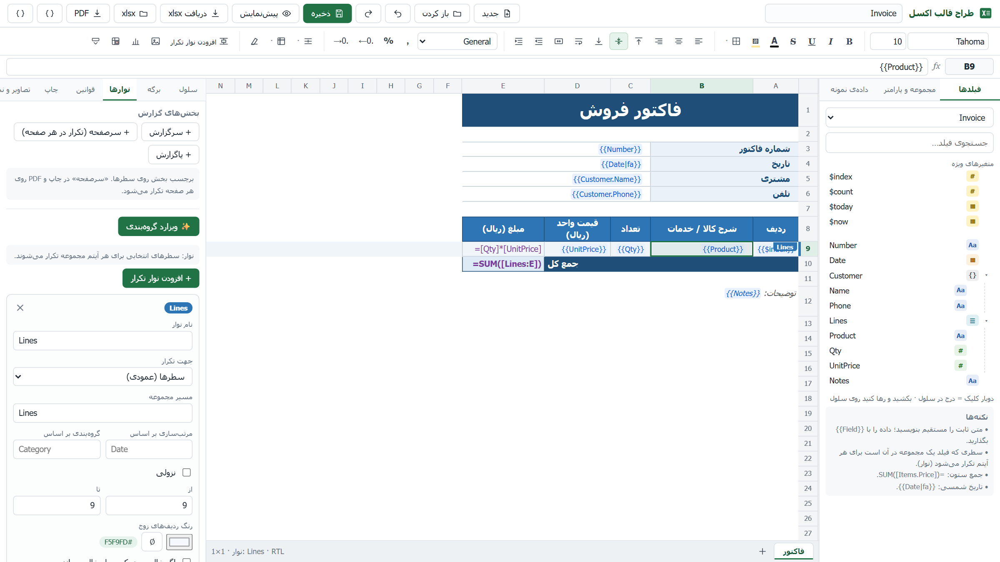
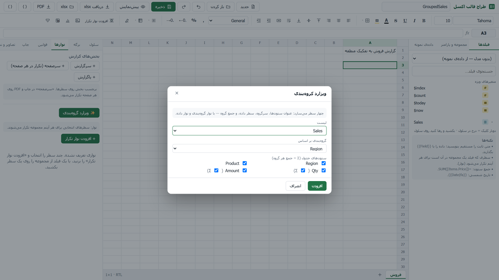
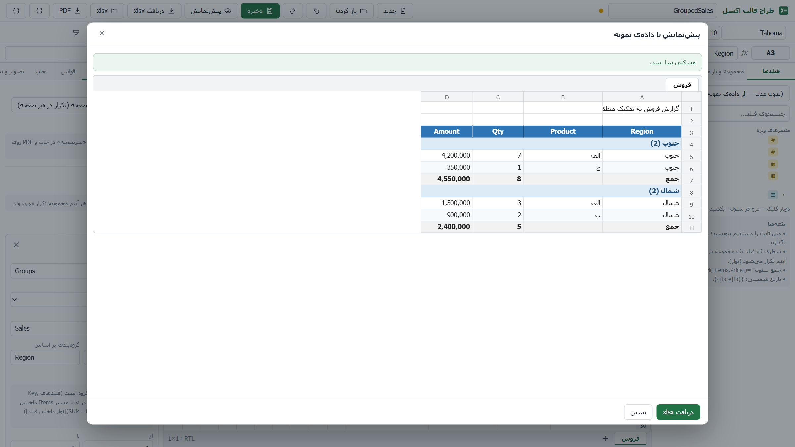
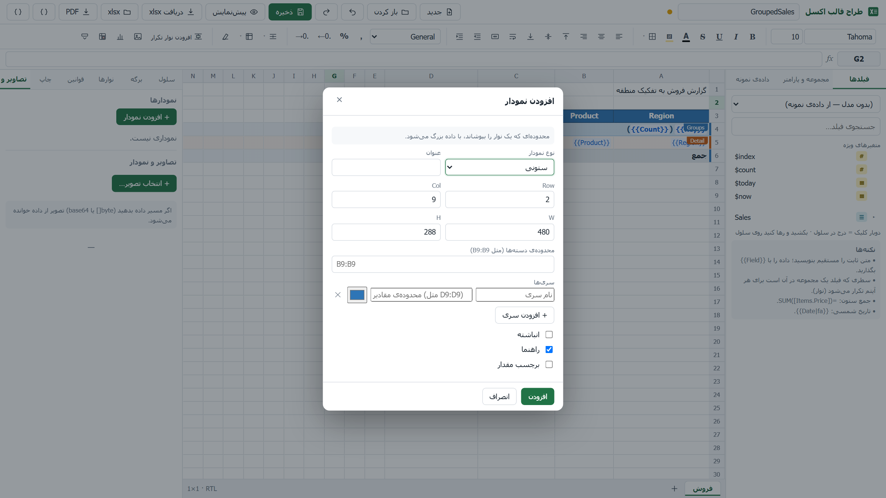
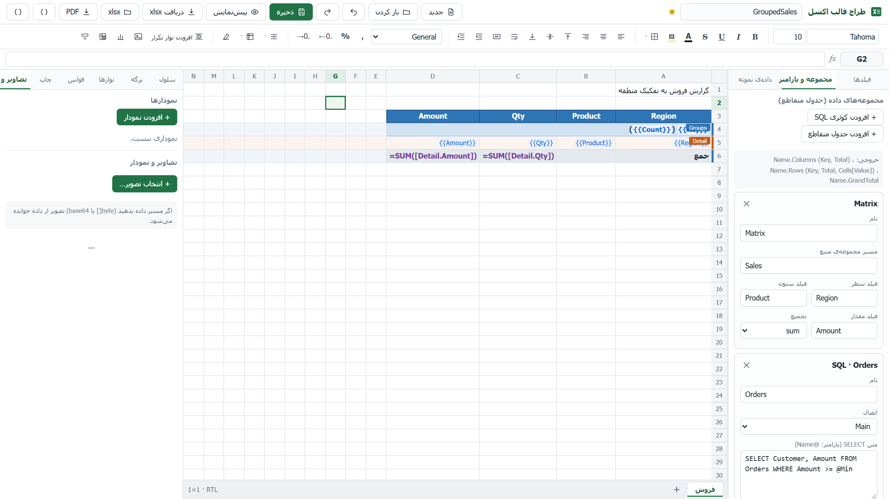
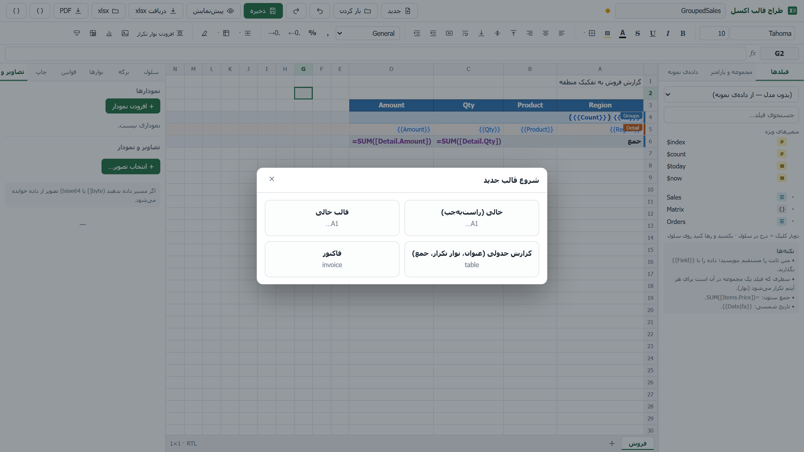
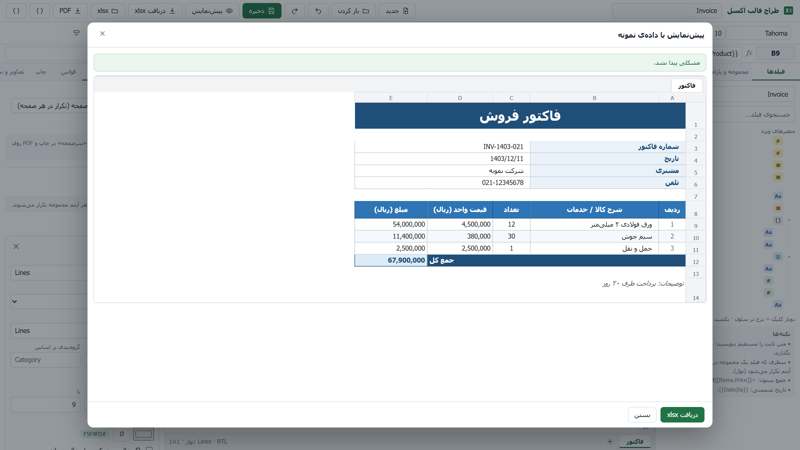
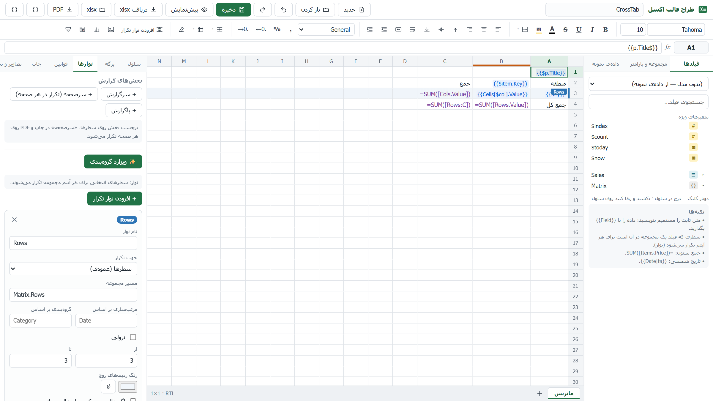
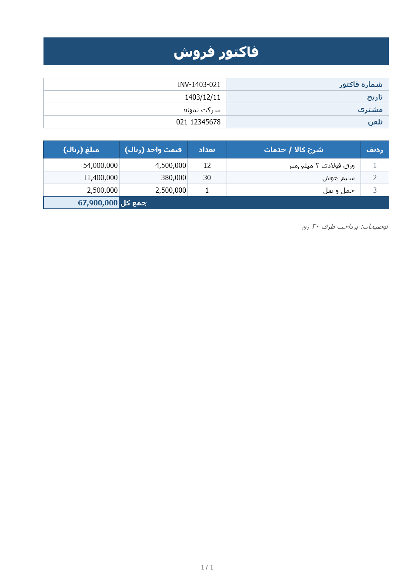

# KSC.Excel — Complete Guide

**A visual Excel/PDF template designer and report engine for .NET and .NET Framework**

Design a template once in a visual designer; your code only supplies data and gets a beautiful `.xlsx` (or PDF) back — no EPPlus / ClosedXML / OpenXML SDK, no Excel installed on the server, no CDN (works on an intranet).

```csharp
return this.ExcelFile("Invoice", model, "invoice.xlsx");                              // Excel
return File(svc.RenderPdf("Invoice", model), "application/pdf", "invoice.pdf");        // PDF
```


> Persian guide: [KSC.Excel-Guide.fa.md](KSC.Excel-Guide.fa.md) · Architecture & design: [../KSC.Excel-Design.md](../KSC.Excel-Design.md) (Persian)

---

## Contents

1. [What is it?](#1-what-is-it)
2. [Quick start: how do I open the designer?](#2-quick-start-how-do-i-open-the-designer)
3. [Installation & requirements](#3-installation--requirements)
4. [Designer tour](#4-designer-tour)
5. [Tutorial: build an invoice](#5-tutorial-build-an-invoice)
6. [Template language](#6-template-language)
7. [Developer guide — .NET 8/10](#7-developer-guide--net-810)
8. [Developer guide — .NET Framework (MVC 5)](#8-developer-guide--net-framework-mvc-5)
9. [Windows desktop designer](#9-windows-desktop-designer)
10. [PDF export](#10-pdf-export)
11. [Huge reports: streaming](#11-huge-reports-streaming)
12. [SQL data sets, parameters, custom functions](#12-sql-data-sets-parameters-custom-functions)
13. [Import from an Excel file](#13-import-from-an-excel-file)
14. [Reference: options & API](#14-reference-options--api)
15. [Security](#15-security)
16. [Deployment](#16-deployment)
17. [Performance & limits](#17-performance--limits)
18. [Troubleshooting & FAQ](#18-troubleshooting--faq)
19. [Building from source, tests, contributing](#19-building-from-source-tests-contributing)
20. [Roadmap & known limitations](#20-roadmap--known-limitations)

---

## 1. What is it?

**The problem.** Producing a good-looking Excel file in an enterprise app usually means picking a library, writing dozens of formatting lines per report, and redeploying for every colour change.

**The solution.**

| Part | Description |
|---|---|
| **Visual designer** | Excel-like grid with a data panel, repeating bands, conditional formats, charts and live preview; Persian/English UI, right-to-left sheets |
| **Engine** | JSON template + data → `.xlsx` / PDF; no spreadsheet library dependency |
| **Hosts** | ASP.NET Core (8/10), ASP.NET MVC 5 (.NET Framework 4.7.2+), Windows desktop app (.NET 10 and .NET Framework 4.8) |
| **Display** | In-page HTML viewer (`KscExcelViewer`), **in-page PDF viewer** (`KscPdfViewer` / `Html.KscPdfViewer`) or file download |

### Packages

| Package | Target | Purpose |
|---|---|---|
| `KSC.Excel` | `netstandard2.0` | Core: template model, render engine, XLSX writer, xlsx importer, HTML preview, designer API + embedded UI |
| `KSC.Excel.AspNetCore` | `net8.0`, `net10.0` | `AddKscExcel`, `MapKscExcelDesigner`, `ExcelFile`, `KscExcelViewer` |
| `KSC.Excel.Mvc` | `net472`, `net48` | `KscExcel.Initialize`, designer route, `ExcelResult`, `Html.KscExcelViewer` |
| `KSC.Excel.Pdf` | `netstandard2.0` | PDF with correct Persian/Arabic shaping (SkiaSharp + HarfBuzz); works on .NET Framework 4.6.1+ **and** .NET 8/10 |
| `KSC.Excel.Designer.Windows` | `net10.0-windows`, `net48` | Windows desktop designer (WPF + WebView2); one source, two runtimes |

The core's only dependency is `Newtonsoft.Json`.

### Key features
- **Data binding:** `{{Field}}`, calculated `{{Qty * Price}}`, filters (`|fa` Persian date, `|round`, …), aggregates, special variables.
- **Structure:** repeating bands and nested bands, sort & group with group totals, **cross-tab** (dynamic columns), sheet repeat, report sections (page header/report header/footer), **group wizard**.
- **File:** live formulas (with cached values), merges, freeze panes, auto-filter, conditional formats (7 kinds), data validation, images (static/dynamic), **charts** (column, bar, line, area, pie), hyperlinks, print setup.
- **External data:** read-only parameterised **SQL**, **REST/JSON endpoints**, **code providers** (EF/Dapper/any service), inline JSON, report parameters, custom functions/filters.
- **Reports like a band designer:** **barcodes & QR codes**, **page break per group**, **watermark**, conditional formats in PDF, rotated text.
- **Scale:** **streaming writer** (1 M rows ≈ 12 s, ≈ 47 MB peak memory).
- **More:** **import an existing xlsx**, **PDF + in-page PDF viewer**, Windows desktop app.
- **Quality:** output verified in real Excel; tests run on .NET 10 and .NET Framework 4.8.

### Architecture at a glance

```text
 template (JSON) ┐
                 ├─► TemplateRenderer ─► RenderedWorkbook ─┬─► XlsxWriter / XlsxStreamSink ─► .xlsx
 data ───────────┘   (bands, formulas…)                     ├─► HtmlPreviewRenderer ──────────► HTML (designer/viewer)
 (POCO/Dict/JSON/DataTable/SQL)                             └─► ExcelPdf (KSC.Excel.Pdf) ─────► PDF
```

---

## 2. Quick start: how do I open the designer?

The designer is a **web page** served by your app (or shown in a desktop window). Four ways:

### A) Run the bundled sample (fastest)

```bash
git clone <repo-url>
cd KSC
dotnet run --project samples/KSC.Excel.Sample.Web --urls http://localhost:5199 -- --environment Development
```

Open in Chrome/Edge:

```text
http://localhost:5199/excel-designer
```

> Without `--environment Development` the designer requires a signed-in user and returns 401 to anonymous visitors — this is intentional (see [Security](#15-security)).

The sample's home page links to the designer, the in-page viewer (`/Home/Viewer`), the Excel download (`/Home/Download`) and PDF (`/Home/Pdf`).

### B) Inside your ASP.NET Core app

```csharp
builder.Services.AddKscExcel();
var app = builder.Build();
app.MapKscExcelDesigner("/excel-designer").RequireAuthorization();   // always behind login
```
Then browse to `https://your-app/excel-designer`.

### C) Inside your .NET Framework (MVC 5) app

```csharp
// Global.asax.cs
KscExcel.Initialize(o => o.TemplateDirectory = "ExcelTemplates");
// RouteConfig.cs
routes.MapKscExcelDesigner();      // /excel-designer
```

### D) Windows desktop app (no browser, no web site)

```bash
dotnet publish src/KSC.Excel.Designer.Windows -c Release -f net10.0-windows -r win-x64 --self-contained false -o artifacts/KSC.Excel.Designer      # .NET 10 Desktop Runtime
dotnet publish src/KSC.Excel.Designer.Windows -c Release -f net48 -o artifacts/KSC.Excel.Designer-net48                              # nothing to install on Windows 10/11 + WebView2
artifacts\KSC.Excel.Designer\KSC.Excel.Designer.exe
```
Details: [section 9](#9-windows-desktop-designer).

---

## 3. Installation & requirements

| Item | Requirement |
|---|---|
| .NET | SDK 8 or 10 to build; matching runtime to run |
| .NET Framework | 4.7.2 / 4.8 for the MVC adapter (core works from 4.6.1) |
| Designer browser | Recent Chrome/Edge/Firefox |
| Excel | **Not required.** Files were verified in desktop Excel 2016+; LibreOffice / Excel Online / Google Sheets were not tested |
| Desktop app | Windows 10/11, .NET 10 Desktop Runtime, WebView2 Runtime (preinstalled on Windows 11) |
| PDF on Linux | A Persian font (e.g. Vazirmatn) and `SkiaSharp.NativeAssets.Linux.NoDependencies` |

### Add to your project
Until the NuGet packages are published, reference the projects directly:

```xml
<ItemGroup>
  <ProjectReference Include="..\KSC.Excel.AspNetCore\KSC.Excel.AspNetCore.csproj" />
  <ProjectReference Include="..\KSC.Excel.Pdf\KSC.Excel.Pdf.csproj" />   <!-- optional: PDF -->
</ItemGroup>
```
After publishing to NuGet: `dotnet add package KSC.Excel.AspNetCore` (and `KSC.Excel.Pdf`).

---

## 4. Designer tour

### 4.1 Screen layout

| Area | Contents |
|---|---|
| **Top bar** | template name · **New** · **Open** · Undo/Redo · **Save** · **Preview** · **Download xlsx** · import xlsx · **PDF** (when `UsePdf()` is on) · export/import JSON |
| **Ribbon** | font & size · bold/italic/underline/strike · text & fill colour · borders · horizontal/vertical align · wrap · merge · indent · number format · structure (insert/delete rows & columns) · freeze · clear format · **add repeat band** · image · chart · conditional format · validation |
| **Formula bar** | cell address · `fx` · value/formula |
| **Left panel** | **Fields** · **Data sets & parameters** · **Sample data** |
| **Grid** | Excel-like cells; bands shown as coloured tags beside the row numbers |
| **Right panel** | **Cell · Sheet · Bands · Rules · Print · Images & charts** |
| **Bottom** | sheet tabs · selection status |

### 4.2 Keyboard shortcuts

| Key | Action | Key | Action |
|---|---|---|---|
| `Ctrl+S` | Save | `F2` / `Enter` | Edit cell |
| `Ctrl+Z` / `Ctrl+Y` | Undo / Redo | `Alt+Enter` | New line inside a cell |
| `Ctrl+B / I / U` | Bold / Italic / Underline | `Tab` / `Shift+Tab` | Next / previous cell |
| `Ctrl+C / X / V` | Copy / Cut / Paste (also from/to Excel) | `Delete` | Clear contents |
| `Ctrl+A` | Select all | `Ctrl+Arrow` | Jump to the data edge |
| `Shift+Click/Arrow` | Extend selection | Right-click | Cell/row/column menu |

In a right-to-left sheet the Right arrow moves to the previous column (as in Excel). Drag a header edge to resize a column/row.

### 4.3 Fields & sample data
- Fields come from a **registered model** (`AddModel<T>`) or are inferred from the **sample JSON**.
- **Drag a field onto a cell** (or double-click it). If the field belongs to a list, **the repeat band for that row is created automatically**.
- Buttons on field nodes: **Σ** (sum of a numeric column) and **ش** (Persian/Jalali date).
- *Sample data* tab: sample JSON of the data you will pass (used only for the designer preview).

### 4.4 Bands & sections



- **Repeat band:** collection path (`Lines`), name, rows, even-row colour, "keep a blank block when empty", **sort**, **group**, direction (rows/columns).
- **Sections:** report header · **page header** (repeats on every printed/PDF page) · report footer — coloured labels on the rows.
- **Group wizard ✨:** pick a list, the group field and the columns; it creates four rows (column titles, group header, detail, group total) plus the bands.





### 4.5 Other panels
- **Cell:** value/formula, value type (auto / always text), link, text direction.
- **Sheet:** name, right-to-left, gridlines, tab colour, zoom, default sizes, "repeat sheet per item", freeze, auto-filter, protect.
- **Rules:** conditional formats (cell value, formula, contains text, duplicates, top/bottom, colour scale, data bar) and validation (list, number, date, length, custom).
- **Print:** orientation, paper, fit to width, margins, header/footer (`&P &N &D &T &A &F`), repeat rows, print area.
- **Images & charts:** static or data-bound logo (`byte[]`/base64); charts with type, title, category range and series.



### 4.6 Data sets & parameters
- **Cross-tab (pivot)**, **SQL query**, **parameters**.



### 4.7 New template & preview



**Preview** runs the template on the sample data, shows every sheet as a tab and lists **template warnings**:



### 4.8 Autosave & moving templates
A draft of every change is kept in the browser and offered back after an accidental close. Real saving is **Save** to the server. **Export/Import JSON** moves templates between environments. `?t=Invoice` opens a template directly.

### 4.9 Template history

With the default file store every save keeps the replaced version in `ExcelTemplates/.history/<name>/` (the last 50; `FileTemplateStore.MaxVersions`, 0 = off). **History** in the top bar lists them (time, size); *Open* puts a version into the designer, *Save* makes it current - the version it replaces goes into the history too, so nothing is ever lost, and a deleted template can still be restored. Custom stores opt in by implementing `IVersionedTemplateStore` (`ListVersions`, `GetVersion`); the button only appears when the store supports it.

---

## 5. Tutorial: build an invoice

Goal: an invoice with customer details, a line-item table, a grand total, and Excel/PDF output (the result is the bundled `Invoice` sample).

**1. Register the model** (once, in `Program.cs`):

```csharp
builder.Services.AddKscExcel(o => { o.AddModel<Invoice>("Invoice"); });
public class Invoice {
    public string Number { get; set; } = ""; public DateTime Date { get; set; }
    public Customer Customer { get; set; } = new(); public List<InvoiceLine> Lines { get; set; } = new();
    public string Notes { get; set; } = "";
}
public class Customer { public string Name { get; set; } = ""; public string Phone { get; set; } = ""; }
public class InvoiceLine { public string Product { get; set; } = ""; public int Qty { get; set; } public decimal UnitPrice { get; set; } }
```

**2.** Open the designer → **New** → "Blank (right-to-left)". In the Fields panel pick the `Invoice` model.

**3. Title:** select A1:E1 → **Merge** → type "Invoice" → font 20 bold, white text, dark-blue fill, centred.

**4. Header block:** drag `Number`, `Date`, `Customer.Name` onto cells. For a Persian date use the **ش** button on the `Date` node (`{{Date|fa}}`). Type labels next to them.

**5. Table header:** type the header row (#, Product, Qty, Unit price, Amount) and style it.

**6. Detail row:** in the next row put `{{$index}}`, then drag `Lines.Product`, `Lines.Qty`, `Lines.UnitPrice`. **The `Lines` band is created automatically** (coloured tag beside the row). Make the Amount column a formula: `=[Qty]*[UnitPrice]`.

**7. Grand total:** the row below the band: "Total" and `=SUM([Lines:E])` (column E = Amount). Apply number format `#,##0`.

**8. Polish:** Bands tab → enable the even-row colour; Sheet tab → turn gridlines off.

**9. Preview** → check warnings → **Save** as `Invoice`.

**10. Use it:**

```csharp
public IActionResult Invoice(int id) => this.ExcelFile("Invoice", _repo.Get(id), $"invoice-{id}.xlsx");
```

> Templates are plain files (`ExcelTemplates/Invoice.kxl.json`) — keep them in Git.

---

## 6. Template language

### 6.1 Text, numbers, values
- Fixed text is typed as is. A fixed number (`123`) is a number; `0912…` (leading zero) and strings over 15 digits stay **text** (Cell panel → "Always text").
- Data: `{{path}}`, e.g. `{{Customer.Name}}`, `{{Lines[0].Product}}`; case-insensitive.
- If the whole cell is **a single** `{{…}}`, the **type is kept** (number/date/bool); mixed with text it becomes a string.
- `null` = empty cell (use `|default:` for a fallback).

### 6.2 Special variables

| Variable | Meaning |
|---|---|
| `{{$index}}` | 1-based row number inside a band |
| `{{$count}}` | number of items in the band (unknown when streaming) |
| `{{$today}}` / `{{$now}}` | today / now (server) |
| `{{$root}}` / `{{$parent}}` / `{{$item}}` | root data / parent item / current item |
| `{{$p.Name}}` | report parameter |

Inside a band, a name not found on the current item is looked up on the parent and then the root.

### 6.3 Filters `{{path | filter:arg}}`

| Filter | Purpose | Example |
|---|---|---|
| `fa` | Persian (Jalali) date as text | `{{Date\|fa}}` → `1404/01/01`, `{{Date\|fa:yyyy/MM/dd HH:mm}}` |
| `fadigits` | Persian digits | `{{N\|fadigits}}` → `۱۲۳۴` |
| `format:pattern` | .NET format | `{{Date\|format:yyyy-MM-dd}}` |
| `round:n` | round | `{{P\|round:1}}` |
| `upper` `lower` `trim` | case/whitespace | |
| `default:text` | fallback for empty | `{{X\|default:-}}` |
| `yesno:Yes/No` | bool to text | `{{Active\|yesno:Yes/No}}` |
| `join:, ` | join a list | `{{Tags\|join:, }}` |
| `truncate:n` | shorten with … | |
| custom | register with `AddFilter` | `{{Rating\|stars}}` |

> Without a filter a date becomes a **real (Gregorian) Excel date** with format `yyyy/mm/dd` (sortable); `|fa` yields Jalali **text**.

### 6.4 Aggregates & expressions
- Aggregates: `{{Count(Lines)}}`, `{{Sum(Lines.Qty)}}`, `Avg`, `Min`, `Max` (static values).
- Expressions: `{{Qty * UnitPrice}}` · `{{IF(Total > 1000, 'VIP', 'Normal')}}` · `{{ROUND(Price * 1.09, 0)}}` · `{{FirstName & ' ' & LastName}}` · `{{COALESCE(Nick, Name)}}` · `{{FA(Date, 'yyyy/MM/dd')}}`.
- Operators: `+ - * / % ^ & = <> < > <= >=`; functions: `IF IFERROR COALESCE ROUND ABS MIN MAX SUM AVG LEN UPPER LOWER TRIM CONCAT AND OR NOT TODAY NOW YEAR MONTH DAY FA`, plus your custom functions.

### 6.5 Repeat bands

| Scenario | How |
|---|---|
| Simple list | a row with `{{Product}}`… and a band `Lines` on that row |
| Several rows per item | band over several rows |
| **Nested** | band `Groups` over rows 1–3 and band `Lines` over row 2 (relative path `Lines`) |
| Empty list | rows vanish; "keep a blank block when empty" keeps one |
| Zebra | even-row fill, except cells with an explicit fill |
| **Sort / group** | `SortBy`, `GroupBy` on a band; each group exposes `Key`, `Count`, `Items` |

**Grouping with group totals:**

| Row | Content | Band |
|---|---|---|
| 1 | `{{Key}} ({{Count}})` | `Groups` (path `Sales`, group by `Region`) over rows 1–3 |
| 2 | `{{Product}}` · `{{Qty}}` | `Detail` (path `Items`) over row 2 |
| 3 | `Total` · `=SUM([Detail.Qty])` | (part of `Groups`) |

(The group wizard builds exactly this.)

### 6.6 Cross-tab
1. **Data sets & parameters** → "Add cross-tab": name `Matrix`, source `Sales`, row `Region`, column `Product`, value `Amount`, aggregate `sum`.
2. A **row** band `Rows` (path `Matrix.Rows`) over the data row.
3. A **column** band `Cols` (path `Matrix.Columns`, direction "columns", column 2 to 2).

| Cell | Content |
|---|---|
| Column header (inside the column band) | `{{$item.Key}}` |
| Data (inside the column band) | `{{Cells[$col].Value}}` |
| Row total | `=SUM([Cols.Value])` |
| Column total | `=SUM([Rows.Value])` (inside the column band) |
| Grand total | `=SUM([Rows:C])` |



In code: `Pivot.Build(data, "Region", "Product", "Amt", "sum")`.

### 6.7 Formulas & tokens
A cell starting with `=` is an Excel formula and stays live. Special tokens are resolved to real addresses at generation time:

| Token | Meaning | Example |
|---|---|---|
| `[Field]` | the field's cell in the **same row** | `=[Qty]*[Price]` → `=C9*D9` |
| `[Band.Field]` | whole column of the field in the band | `=SUM([Lines.Qty])` → `=SUM($C$9:$C$11)` |
| `[Band:E]` | whole column `E` in the band | `=SUM([Lines:E])` |
| `[ColBand.Field]` | **horizontal** range in the same row of a column band | `=SUM([Cols.Value])` |

`{{…}}` inside a formula is substituted too (`=C9*{{TaxRate}}`). Empty band → token becomes `0`. **Cached values** are computed for common functions (`SUM AVERAGE MIN MAX COUNT COUNTA ABS ROUND IF IFERROR AND OR NOT CONCAT LEN UPPER LOWER TRIM SUMIF COUNTIF`); other Excel functions (e.g. `VLOOKUP`) are written as is and work in Excel. Fixed `A1` references are **not** adjusted when rows/columns move — use tokens.

### 6.8 Sheet repeat, links, dynamic images
- **Sheet repeat:** Sheet panel → "Repeat sheet per item" = `Branches` (the sheet name may contain `{{Name}}`).
- **Link:** Cell panel → link: `https://site/{{Id}}` or `#Sheet2!A1`.
- **Dynamic image:** data path of the image (`Company.Logo`, `byte[]` or base64).

### 6.9 Advanced reporting: multi-level groups, calculated columns, Jalali calendar

**Multi-level grouping with subtotals.** In the *Bands* tab, *Group wizard* now offers a **second grouping level**, a **grand total row** and group keys written as **expressions**. It builds nested bands (`Groups` → `SubGroups` → `Detail`) with a header and a subtotal row per level. Totals use `SUBTOTAL(9, …)`, exactly like Excel's *Subtotal* command: a total over a range ignores the subtotals inside it, so nested totals never double count (the engine computes the cached values the same way). By hand: put the same formula `=SUBTOTAL(9,[Detail.Amount])` in every subtotal row; a token such as `[Detail.Amount]` now covers **all** detail rows below the current group, including those of nested groups.

**Group / sort by an expression.** `GroupBy` and `SortBy` accept an expression when they start with `=`: `=JYEAR(Date)`, `=JYM(Date)` (Jalali year/month), `=IF(Qty>10,"big","small")`. In the designer type it in the wizard's "or expression" box.

**Calculated columns** (inside `{{ }}`, evaluated per band item over the whole band, or per group inside a group):

| Function | Meaning |
|---|---|
| `RUNSUM(Qty)` | running total up to this row |
| `PCT(Qty)` | share of the band total (0-1; format the cell as `0%`) |
| `PREV(Qty)` / `DIFF(Qty)` | previous row's value / difference from it |
| `RANK(Qty)` | rank, 1 = largest |
| `MOVAVG(Qty, 3)` | moving average of the last 3 rows |

They need the whole collection, so they are not available in streaming mode (the cell is empty there).

**Jalali (Persian) calendar.** Dates stay real Gregorian dates in the file; these helpers do the Jalali part:

| Expression / filter | Result |
|---|---|
| `JYEAR(D)` `JMONTH(D)` `JDAY(D)` `JQUARTER(D)` | numbers |
| `JMONTHNAME(D)`, `{{D\|jmonthname}}` | month name (فروردین …) |
| `JYM(D)`, `{{D\|jym}}` | `1404/02` text, handy as a group key |
| `JDAYNAME(D)` | weekday name |
| `JDATE(1404,1,1)` | Jalali date → real date |
| `JPARSE('1404/02/10')` | text (Persian digits allowed) → real date |
| `{{D\|fa}}` | `1404/02/06` text (as before) |

Report parameters of type **`jdate`** accept Jalali text from the designer default or from code: `new Dictionary<string, object> { ["From"] = "1404/01/01" }`; the template sees a real date (`{{$p.From|fa}}`, SQL `@From`).

### 6.10 Combo charts

In the chart dialog every series has its own **type** (column / line / area) and a **secondary axis** check box: columns for amounts plus a line for a percentage on the right-hand axis. Works in `.xlsx` (verified in Excel: one column series on the primary axis, one line series on the secondary axis) and in PDF. In JSON: `{ "values": "C9:C9", "type": "line", "secondary": true }`. Horizontal bar and pie charts ignore the per-series type.

### 6.11 Filter and Top-N on a band

Band settings (*Bands* tab): **Filter** keeps only the items for which an expression is true (`Qty > 10`, `AND(Qty > 10, Status = 'open')`); **Top** keeps the first N items, ranked by **Rank by** (a path such as `Amount`, or an expression such as `=Sum(Items.Amount)` to rank groups by their total); *Smallest first* gives "bottom N". Order of work: filter → sort → group → rank → Top. Totals and charts see only the kept items. Streaming falls back to the buffered render for such a band. ("Other" rows that aggregate the rest are not built in; add a second band or a calculated total.)

---

## 7. Developer guide — .NET 8/10

### 7.1 Setup

```csharp
using KSC.Excel.AspNetCore;
using KSC.Excel.Pdf;

builder.Services.AddControllersWithViews();
builder.Services.AddKscExcel(o =>
{
    o.AddModel<Invoice>("Invoice");      // fields + sample data for the designer
    o.UsePdf();                          // PDF button in the designer (optional)
});

var app = builder.Build();
app.UseRouting();
app.UseAuthentication(); app.UseAuthorization();

app.MapKscExcelDesigner("/excel-designer").RequireAuthorization("Admin");  // the designer
app.MapKscExcelDownloads();                                                 // viewer download links
app.MapDefaultControllerRoute();
```

Templates live in `{ContentRoot}/ExcelTemplates/*.kxl.json` by default. Ship them: `<Content Include="ExcelTemplates\**" CopyToOutputDirectory="PreserveNewest" />`.

### 7.2 Producing files

```csharp
public class ReportsController : Controller
{
    private readonly IExcelReportService _excel;
    public ReportsController(IExcelReportService excel) => _excel = excel;

    public IActionResult Invoice(int id) =>
        this.ExcelFile("Invoice", _repo.Get(id), $"invoice-{id}.xlsx");                 // download

    public IActionResult Sales(DateTime from) =>
        this.ExcelFile("Sales", _repo.Query(from), new Dictionary<string, object> { ["From"] = from }, "sales.xlsx");   // with parameters

    public IActionResult Big() => this.ExcelFileStreaming("Big", _repo.StreamRows(), "big.xlsx");   // streaming

    public IActionResult InvoicePdf(int id) =>
        File(_excel.RenderPdf("Invoice", _repo.Get(id)), "application/pdf", "invoice.pdf");        // PDF
}
```

**Minimal API:** `app.MapGet("/r", (IExcelReportService x) => x.File("Invoice", data, "invoice.xlsx"));`

**Without a web host (job/service):**
```csharp
byte[] bytes = svc.Render("Invoice", model);
File.WriteAllBytes("invoice.xlsx", bytes);
svc.Render(svc.GetTemplate("Invoice"), model, outputStream);     // straight to a Stream
```

### 7.3 Showing the report in a page (viewer)

```cshtml
@await Component.InvokeAsync("KscExcelViewer", new { template = "Invoice", data = Model, downloadName = "invoice" })
@* or: @addTagHelper *, KSC.Excel.AspNetCore  →  <vc:ksc-excel-viewer template="Invoice" data="Model" /> *@
```

| Parameter | Default | Description |
|---|---|---|
| `template` | — | template name |
| `data` | — | data |
| `downloadName` | template name | download file name |
| `showDownload` | `true` | download button |
| `showHeaders` | `false` | Excel-like A,B,C / 1,2,3 headers |
| `downloadLabel` | "Download Excel" (fa: Persian) | button text |

The download link is an unguessable 144-bit token, valid 15 minutes, bound to the signed-in user, served from the memory of the same server (max 64 files).

### 7.4 Input data
`data` can be a class/DTO, `Dictionary<string, object>`, `ExpandoObject`, `JObject/JToken`, `DataTable/DataRow/DataView`, or a mix. Names are case-insensitive. For streaming pass **lazy** sequences (`IEnumerable` with `yield`, a `DataReader`).

### 7.5 `IExcelReportService`

| Method | Purpose |
|---|---|
| `Render(name, data)` / `(name, data, parameters)` | `byte[]` xlsx from a stored template |
| `Render(template, data)` / `(template, data, Stream)` | from a template object / into a Stream |
| `RenderStreaming(name\|template, data, Stream, parameters?)` | streaming; returns `bool` (false = fell back to normal render) |
| `RenderHtml(name\|template, data, showHeaders)` | HTML for a page |
| `Bind(template, data, parameters?)` | `RenderedWorkbook` + `Warnings` |
| `BindPreview(template, data, parameters?)` | like `Bind`, but skips SQL when not allowed (designer) |
| `GetTemplate(name)` / `Store` | template / storage |
| `svc.RenderPdf(...)` (Pdf package) | PDF |

### 7.6 Code-first templates

```csharp
var b = new TemplateBuilder("Report", "Report");
var head = b.Style("h", new StyleDef { Bold = true, Fill = "#2E75B6", Color = "#FFFFFF", H = "center" });
b.Sheet("Report", s =>
{
    s.Cell("A1", "Name", head).Cell("B1", "Amount", head);
    s.Cell("A2", "{{Name}}").Cell("B2", "{{Amount}}");
    s.Band("Rows", "Rows", 2, 2, "#F5F9FD");
    s.Cell("A3", "Total").Cell("B3", "=SUM([Rows.Amount])");
    s.Freeze(1);
});
byte[] xlsx = svc.Render(b.Build(), new { Rows = data });
```
Good for default templates shipped with your app (`store.Save(template)` at startup).

### 7.7 Template storage (`ITemplateStore`)

```csharp
public sealed class DbTemplateStore : ITemplateStore
{
    public IList<TemplateInfo> List() => /* SELECT Name, Title, Modified */;
    public ExcelTemplate Get(string name) { var json = /* SELECT Json */; return json == null ? null : ExcelTemplate.FromJson(json); }
    public void Save(ExcelTemplate t) { /* UPSERT t.Name, t.ToJson() */ }
    public bool Delete(string name) => /* DELETE */;
}
builder.Services.AddKscExcel(o => o.Store = new DbTemplateStore(...));
```
Validate names with `TemplateNames.IsValid(name)`.

### 7.8 Testing templates
```csharp
var wb = svc.Bind(svc.GetTemplate("Invoice"), sampleData);
Assert.Empty(wb.Warnings);                       // a warning-free template
var bytes = XlsxWriter.ToBytes(wb);              // inspect with ZipArchive if needed
```

### 7.9 Other output formats: Word, CSV, HTML, PNG

```csharp
return this.ReportFile("Invoice", model, ReportFormat.Docx);        // ASP.NET Core:  xlsx | pdf | csv | docx | html | png
return this.Report("Invoice", model, ReportFormat.Csv);             // MVC 5
var file = svc.Export(options, "Invoice", model, null, ReportFormat.Docx);   // bytes + ContentType + Extension, anywhere
```

| Format | What you get | Notes |
|---|---|---|
| `Xlsx` | the Excel file | |
| `Pdf`, `Png` | PDF / one page as image (`page` argument) | need `o.UsePdf()` |
| `Csv` | one sheet (`page` = sheet number), UTF-8 with BOM, quoted, **formula-injection safe** (`=`, `+`, `-`, `@` text gets a `'`) | Persian opens correctly in Excel |
| `Docx` | Word document: one table per sheet, merged cells, fills, borders, fonts, RTL, barcode/logo images, page size/orientation | no Word needed; charts are not included; verified by opening in real Word |
| `Html` | stand-alone HTML page (all sheets, direction from the sheet) | |

### 7.10 Report server, parameters and drill-down

Publish reports and users get a page with a **parameter form**, an HTML or PDF view and download buttons, without writing a controller:

```csharp
builder.Services.AddKscExcel(o =>
{
    o.UsePdf();
    o.AddReport("Sales", p => repo.Sales((DateTime)p["From"], (double)p["Min"]), title: "گزارش فروش");   // data = code that receives the typed parameters
    o.AddReport("Customer", p => repo.Customer((string)p["Id"]));
});
app.MapKscExcelReports("/reports").RequireAuthorization();           // MVC 5: routes.MapKscExcelReports(); KscExcel.AuthorizeReports = ctx => ...
```

- `/reports` lists the registered reports. `/reports/Sales?p_From=2025-03-21&p_Min=100` shows one (**query names are `p_<ParameterName>`**). Parameters come from the template's *Data sets & parameters* tab: types `text`, `number`, `date`, **`jdate`**, `bool`; a drop-down appears when the parameter has **Options** (`A|B|C` or `a:Alpha|b:Beta`).
- `?format=pdf|xlsx|docx|csv|html|png` returns the file (pdf/png/html open in the browser, the rest download; add `&download=1` to force a download); `?view=pdf` shows the PDF inside the page.
- **Drill-down:** a cell link `report:Customer?Id={{CustomerId|urlenc}}` becomes `/reports/Customer?p_Id=...`: click a row of a summary report to open the detail report. Use `|urlenc` for every value in the link.
- In your own pages: `@await Component.InvokeAsync("KscExcelViewer", new { ..., showParameters = true })` (also `KscPdfViewer`; MVC: `Html.KscExcelViewer(..., showParameters: true)`) draws the same form above the viewer; read the chosen values in the action with `this.GetReportParameters("Sales")`.
- Safety: only reports registered in code can be run (a template name in the URL does nothing); parameters are typed and ignored when invalid; unexpected errors show a generic message and go to `o.OnReportError`. **Reports expose your data: protect the route.**

### 7.11 Scheduling and e-mail

```csharp
builder.Services.AddKscExcelScheduler(s => s
    .UseSmtp(new SmtpOptions { Host = "smtp.example.com", Port = 587, User = "...", Password = "...", From = "reports@example.com" })
    .Add(new ReportJob
    {
        Name = "DailySales", Report = "Sales", Format = ReportFormat.Pdf,
        Schedule = ReportSchedule.Daily(TimeSpan.FromHours(7)),
        ParameterFactory = now => new Dictionary<string, object> { ["From"] = now.Date.AddDays(-1) },     // "yesterday"
        To = { "manager@example.com" }, Subject = "Sales report", SaveToFolder = @"D:\Reports"
    }));
// MVC 5 / any host:  KscExcel.StartScheduler(s => ...);   or  new ReportScheduler(options, service).Add(...).Start();
```

Schedules (server local time): `Daily`, `Weekly(DayOfWeek, time)`, `Monthly(day, time)` (clamped: 31 = last day), **`MonthlyJalali(day, time)`** (Persian calendar), `EveryMinutes(n)`. A job that was missed (server down) runs **once**, never as a burst; a run still in progress is not started twice; failures are reported to `scheduler.OnRun` and never stop other jobs. Sinks: e-mail (SMTP, attachment), folder, or your own `IReportSink`. `RunNow("DailySales")` runs a job on demand. The timer lives inside the application: if the host recycles or sleeps (IIS idle time-out) use a service/Job runner that calls `RunDueJobs()`.

### 7.12 Report access control and audit trail

```csharp
builder.Services.AddKscExcel(o =>
{
    o.AddReport("Finance", p => repo.Finance(p), roles: new[] { "Finance", "Admin" });                         // role rule
    o.AddReport("Corp", p => repo.Corp(p), authorize: u => u.Identity.Name.EndsWith("@corp.com"));             // custom rule
    o.AddContextReport("MyOrders", c => repo.Orders(c.User.Identity.Name), roles: new[] { "Sales" });         // row-level: the data function gets the user
    o.Audit = new FileReportAudit("logs/reports");                                                             // or: new DelegateReportAudit(e => log...)
});
```

- The report server answers **401** (not signed in) / **403** (signed in, not allowed) **before** the data function runs; the catalog lists only the reports the user may open. Roles and the custom rule both must pass.
- **Row-level security:** `AddContextReport` hands your function a `ReportContext` (`Parameters`, `User`) - return only that user's rows. A user can never pick another user's data through a URL parameter because the filter is in your code.
- **Audit:** every run, denial and failure becomes an entry (time, user, report, action = view/pdf/xlsx/..., status, parameters, duration). `FileReportAudit` writes one JSON line per event into `audit-yyyyMMdd.jsonl`. Parameters named like *password / token / key / secret* are masked (`***`); a failure records only the exception **type**, never its message; a failing audit sink never breaks the report. Scheduled jobs are audited as user `scheduler` and are not subject to role rules (the job definition is the authority).
- Your own controllers are not covered automatically: use `[Authorize]` there, and call `options.Audit.Log(...)` yourself if you want them in the trail.

---

## 8. Developer guide — .NET Framework (MVC 5)

Reference `KSC.Excel` and `KSC.Excel.Mvc` (adapter targets `net472`/`net48`; the core works from 4.6.1).

```csharp
// Global.asax.cs
protected void Application_Start()
{
    AreaRegistration.RegisterAllAreas();
    KscExcel.Initialize(o => { o.TemplateDirectory = "ExcelTemplates"; o.AddModel<InvoiceVm>("Invoice"); });
    KscExcel.Authorize = ctx => ctx.User.IsInRole("Admin");      // optional; the user must be signed in
    RouteConfig.RegisterRoutes(RouteTable.Routes);
}

// RouteConfig.cs  (before the default MVC route)
routes.MapKscExcelDesigner();          // /excel-designer
routes.MapKscExcelDownloads();         // for Html.KscExcelViewer (after Initialize)
```

```csharp
// Controller
using KSC.Excel.Mvc;
public ActionResult Invoice(int id) => this.Excel("Invoice", _svc.Get(id), "invoice.xlsx");
public ActionResult Sales() => this.Excel("Sales", data, new Dictionary<string, object> { ["From"] = DateTime.Today }, "sales.xlsx");
public ActionResult Big() => this.ExcelStreaming("Big", reader, "big.xlsx");
```
```cshtml
@using KSC.Excel.Mvc
@Html.KscExcelViewer("Invoice", Model, "invoice")
```

- Without DI use `KscExcel.Service` (the same `IExcelReportService`).
- IIS: Integrated pipeline. If `/excel-designer/assets/*.js` returns 404, check `UrlRoutingModule` or set `<modules runAllManagedModulesForAllRequests="true" />`.
- **Verified on real IIS Express** (.NET Framework 4.8, System.Web + MVC 5.2.9): the sample `samples/KSC.Excel.Sample.Mvc5` serves the designer, viewer, PDF viewer, Excel and PDF downloads. Run it: `iisexpress.exe /path:samples\KSC.Excel.Sample.Mvc5 /port:5290`.
- **PDF works on .NET Framework** (`KSC.Excel.Pdf` is `netstandard2.0`): call `o.UsePdf()` in `KscExcel.Initialize`, then `this.Pdf("Invoice", model, "invoice.pdf")` or `Html.KscPdfViewer(...)`. SkiaSharp needs binding redirects in `web.config` (System.Runtime.CompilerServices.Unsafe 6.0.3.0, System.Memory, System.Buffers, System.Numerics.Vectors) - the sample's `web.config` has them; classic MVC projects get them automatically from *Add binding redirects*.

---

## 9. Windows desktop designer

The same web designer runs in `WebView2` (**.NET 10 or .NET Framework 4.8** - pick the build that matches the machine) and its **API is served in-process** (`https://kxl.local`; no Kestrel, no port). Look, features and the **template format are identical**.

```bash
dotnet publish src/KSC.Excel.Designer.Windows -c Release -r win-x64 --self-contained false -o artifacts/KSC.Excel.Designer
artifacts\KSC.Excel.Designer\KSC.Excel.Designer.exe            # or:  KSC.Excel.Designer.exe "C:\path\Invoice.kxl.json"
```

- Templates default to `Documents\KSC Excel Templates`; **File → Choose templates folder** lets you point at your project's folder (e.g. `ExcelTemplates` in Git). The setting is stored in `%APPDATA%\KSC.Excel.Designer\settings.json`.
- Menus: New · **Open `.kxl.json` file** · Save · Save as JSON · **Import from Excel file** · **Export Excel and PDF with sample data** · choose/show folder · reload · DevTools.
- Limitation: `AddModel<T>` and SQL connections cannot be registered in the desktop app; provide sample JSON instead.
- Self test: `KSC.Excel.Designer.exe --selftest out.txt`.

---

## 10. PDF export

```csharp
using KSC.Excel.Pdf;
byte[] pdf = svc.RenderPdf("Invoice", model);                          // with parameters: svc.RenderPdf("Sales", data, parameters)
ExcelPdf.Render(svc.Bind(template, data, null), stream, new PdfOptions { FontFile = "/fonts/Vazirmatn.ttf" });
byte[] png = ExcelPdf.RenderPng(wb, pageNumber: 1);                    // image preview
```



| | Supported |
|---|---|
| Persian/Arabic text | correct shaping (HarfBuzz), mixed Persian + digits + Latin ordering (bidi), RTL sheets |
| Cells | fill, borders, font/size/bold/italic/underline, alignment, wrap, indent, merges, number formats, formulas |
| Pages | A4/A3/A5/Letter/Legal, orientation, margins, scale/fit-to-width, **repeating title rows and page header**, header/footer (`&P &N &D &T &A &F &L &C &R`), pagination |
| Images/charts | images; column, bar, line, area, pie charts |
| Links | clickable `http/https/mailto` |

**Not supported:** auto-filter arrows, cell comments. The result is very close to, but not pixel-identical with, Excel's own "Save as PDF".

**Fonts:** cell font → `FallbackFontFamily` (Tahoma) → Segoe UI/Arial/Noto/DejaVu → OS font manager. On **Linux/Docker** install a Persian font or set `PdfOptions.FontFile`, and add `SkiaSharp.NativeAssets.Linux.NoDependencies`. Page cap: `PdfOptions.MaxPages` (2000).

### 10.1 PDF viewer in the page

Show the report as a PDF inside your page (the browser's PDF reader: page navigation, zoom, search, print) with **Download PDF / Download Excel / Print** buttons. No JavaScript library, no CDN.

```cshtml
@* ASP.NET Core *@
@await Component.InvokeAsync("KscPdfViewer", new { template = "Invoice", data = Model, downloadName = "invoice", showExcel = true, height = "75vh" })

@* .NET Framework MVC 5 *@
@Html.KscPdfViewer("Invoice", Model, "invoice", height: "75vh", showExcel: true)
```

Requirements: `options.UsePdf()` (KSC.Excel.Pdf) and the download route (`app.MapKscExcelDownloads()` / `routes.MapKscExcelDownloads()`). Controller one-liners:

```csharp
return this.PdfFile("Invoice", model, "invoice.pdf");                        // ASP.NET Core  (inline: true = show in the browser)
return this.Pdf("Invoice", model, "invoice.pdf");                            // MVC 5         (inline: true = show in the browser)
app.MapGet("/r", (IExcelReportService s, KscExcelOptions o) => s.Pdf(o, "Invoice", model));   // minimal API
```

Parameters of the viewer: `template`, `data`, `parameters` (report parameters), `downloadName`, `height` (CSS), `showToolbar`, `showExcel`.

### 10.2 What PDF supports

Everything in the table above **plus**: conditional formatting (same engine as the HTML preview), rotated and vertical text, text that spills into empty neighbouring cells (like Excel), shrink-to-fit, data bars / colour scales, **barcodes and QR codes as crisp vector shapes**, **watermark**, **page break per group**, and crisp vector output for everything except images.

### 10.3 Barcodes and QR codes

Select a cell, set **Barcode** in the Cell panel (`QR Code`, `QR Code (L)`, `QR Code (H)`, `Code 128`) and write the content as usual: `{{Number}}`, `https://pay.example.com/{{Id}}`. The text is encoded and drawn as an image that fills the cell (merge cells for a bigger code). It works inside repeating bands (one code per row), in `.xlsx` (PNG image), in the HTML preview as a marker and in **PDF as vector shapes**.

- **QR:** byte mode (UTF-8, so Persian works), versions 1-10 (about 270 bytes at level L), ECC L/M/Q/H (`qr:L`, `qr:M`, `qr:Q`, `qr:H`; default M). Verified against an independent decoder in the test-suite.
- **Code 128:** printable ASCII; digit-only values of even length use the compact set C automatically.
- **EAN-13 / EAN-8** (`ean13`, `ean8`): digits; give 12 (7) digits and the check digit is added, or 13 (8) digits with a valid check digit. **Code 39** (`code39`): `0-9 A-Z - . space $ / + %`. All verified with an independent decoder. (PDF417 and Data Matrix are not included.)
- Text that cannot be encoded produces a warning and no image (the rest of the report still renders).
- Template JSON: `{ "r": 14, "c": 1, "v": "{{Number}}", "bc": "qr" }`. Barcode cells are not available for the streaming writer.

### 10.4 Watermark and page breaks

- **Watermark** (PDF): Print panel → *Watermark*, or `PdfOptions.Watermark = "DRAFT"` (overrides the template). Diagonal, light grey, on every page, any script.
- **Page break per item**: Bands panel → *Start each item on a new page* (`BandDef.PageBreak`) - one invoice / one group per page. Written to `.xlsx` as manual page breaks (`rowBreaks`) and honoured by the PDF paginator.

### 10.5 Password protection and permissions

```csharp
var pdf = svc.RenderPdf("Invoice", model, null, new PdfOptions
{
    Security = new PdfSecurity { UserPassword = "1234", OwnerPassword = "boss", AllowCopy = false, AllowModify = false }
});
```

AES-256 (PDF 2.0 standard security handler). `UserPassword` is needed to open the file; with an empty user password anyone can open it but the denied permissions (`AllowPrint`, `AllowCopy`, `AllowModify`, `AllowAnnotate`) are enforced by compliant readers, and the owner password lifts them. Verified by decrypting with an independent library. Note that permissions are advisory for readers that choose to ignore them; use a user password when confidentiality matters.

### 10.6 Carried-forward page totals

Print panel → **Carried totals**: band name (e.g. `Detail`) and columns (e.g. `D,E`). Every PDF page then ends with a **"Carried forward"** row holding the running total and the next page starts with **"Brought forward"** with the same figures (the number format of the column is used; labels are configurable: `CarryLabelOut`, `CarryLabelIn`). Cells with formulas (group subtotals) are not counted, so grouped reports stay correct. The pages in between reserve two extra rows automatically.

### 10.7 Printed forms: waybills, accounting attachments, daily reports

Fixed-layout paper forms (a company header with a logo, label/value grids, a table that fills the page, signature lines, "page x of y") are ordinary templates; three settings make them look like the printed originals:

| Setting | Where | Effect |
|---|---|---|
| **Persian digits** | Print panel → *Persian digits* (`Page.PersianDigits`, or `PdfOptions.PersianDigits`) | every digit in the PDF and the HTML preview shows as ۰-۹ (numbers, dates, `&P &N` page numbers); the `.xlsx` keeps real numbers |
| **Frame around the page** | Print panel → *Frame around the page* (`PageFrame`, `FrameColor`) | a rectangle around the printable area of every page |
| **Minimum rows** | Bands tab → *Minimum rows* (`BandDef.MinRows`) | pads the table with blank rows so a form always has e.g. 25 lines; `{{IF($pad, '', $index)}}` hides the numbers of padding rows; real rows are never cut |

Also: rows without a fixed height **grow to fit wrapped text** in the PDF (like Excel's auto-fit); multi-level merged headers, vertical merges, borders, fills and a logo (Images tab) work as in Excel; a table header row is repeated on every following page with *Repeat rows* (`PrintTitleRows`, e.g. `8:8`); put `&Cصفحه &P از &N` in the footer for "page x of y".

Worked examples (in the private KSC repository, `samples/KSC.Excel.Samples.Industrial`): a **waybill** (form with header blocks, a product table with totals and a second table per item from the same data), a multi-page **shipping attachment** (frame, repeated header, 100 rows, total) and a landscape **daily shipment report** (three-level merged header and three small tables). Each is a template in `ExcelTemplates/*.kxl.json` that opens in the designer; the PDF has the same page count as the original forms.

---

## 11. Huge reports: streaming

```csharp
bool streamed = svc.RenderStreaming("BigReport", new { Title = "…", Items = repo.StreamRows() }, outputStream);
```
- Measured: **1,000,000 rows × 6 columns ≈ 12.6 s, ≈ 47 MB peak memory** (30 MB file); 100 k rows ≈ 2 s. Only `MaxRows` applies.
- If a template is not streamable, `RenderStreaming` falls back to the normal render and returns `false`; reasons: `StreamAnalyzer.Check(template)`. Rules: totals must be **below** their band, `[Field]` must not refer to a later row, no `{{$count}}`, frozen rows above every band.
- Differences: strings are `inlineStr` and formulas have **no cached values** (Excel calculates on open).
- An error mid-write leaves a partial file in `output`; the adapters write to a temp file.

---

## 12. SQL data sets, parameters, custom functions

### Parameters
Data sets & parameters tab → name, type (`text/number/date/bool`), default; in the template `{{$p.Title}}`; in code:
```csharp
svc.Render("Sales", data, new Dictionary<string, object> { ["Title"] = "Spring sales", ["From"] = DateTime.Today });
```

### SQL
```csharp
o.AllowSql = true;                                                           // default false
o.AddConnection("Sales", SqlClientFactory.Instance, connectionString);       // any DbProviderFactory
o.SqlCommandTimeoutSeconds = 30; o.SqlMaxRows = 100000;
```
In the designer: "Add SQL query" → name (`Orders`), connection, `SELECT … WHERE Amount >= @Min` (`@Min` is bound from the report parameter with that name — **never string concatenation**). "Test query" discovers the columns. Then a band with path `Orders`.
**Safety:** a single `SELECT`/`WITH` only; `INSERT/UPDATE/DELETE/DROP/EXEC/INTO/;` are rejected. This is only the second layer — **use a read-only database login**. With `AllowSql=false` and a SQL template, generation fails with a clear error; the designer preview uses same-named sample data instead.

### REST / JSON / code providers (any data source)

SQL is one source; the engine can read **anything** through three more kinds of data sets. The template only *names* a source; **what the source is, is decided in your code** (a template author can never point the engine at another server).

```csharp
builder.Services.AddKscExcel(o =>
{
    // 1) your own code returns the data (EF, Dapper, a service call...) from the report parameters
    o.AddProvider("Orders", p => db.Orders.Where(x => x.Year == (int)p["Year"]).ToList());

    // 2) a REST endpoint: fixed host + headers (API key); templates give only the path
    o.AddHttpEndpoint("Crm", "https://crm.example.com/api/", new Dictionary<string, string> { ["X-Api-Key"] = key }, timeoutSeconds: 30);
});
```

In the designer (*Data sets & parameters* tab): **+ Add JSON / REST data** or **+ Add code provider**.

| Data set type | Fields | Example |
|---|---|---|
| `provider` | `connection` = provider name | `Orders` |
| `json` + endpoint | `connection` = endpoint, `url` = path/query (`{Name}` = URL-encoded report parameter), `jsonPath` = where the array is | `orders?year={Year}`, `data.items` |
| `json` inline | `json` = fixed JSON text (lookup tables, constants) | `[{"Code":"A","Title":"Alpha"}]` |

Then use the data set name as a band source (`Orders`, `Orders.Lines`...) or as a cross-tab source, like a SQL data set. **Test** loads the data set, shows the row count and fills the field tree with the discovered columns.

Safety: only http/https; a URL cannot leave the registered host/scheme; 30 s timeout and 20 MB response cap by default (`HttpEndpoint`); in the designer preview a failing source becomes a warning and the sample data is used.

### Custom filters & functions
```csharp
o.AddFunction("Tax", a => Convert.ToDecimal(a[0]) * 0.09m);      // {{Tax(Price)}} and the cached value of =TAX(B2)
o.AddFilter("stars", (value, arg) => new string('*', Convert.ToInt32(value)));   // {{Rating|stars}}
```

---

## 13. Import from an Excel file

The **xlsx** button (or the desktop menu) converts an `.xlsx` into a template: sheets, values, **formulas**, fonts/colours (including theme colours)/borders/alignment/number formats, merges, widths/heights, freeze panes, filter, RTL, conditional formats, validation, hyperlinks, **images**, print setup. Then replace data cells with `{{Field}}` placeholders and add bands. **Not imported:** charts, PivotTables, Excel tables (come in as plain cells), macros. Safety: no XXE, 50 MB / 500 k cell limits. In code: `XlsxImporter.Import(bytes, "Name").Template`.

---

## 14. Reference: options & API

### `KscExcelOptions`

| Option | Default | Description |
|---|---|---|
| `TemplateDirectory` | `ExcelTemplates` | template folder (relative to ContentRoot / site root) |
| `Store` | files | custom storage |
| `DesignerTitle` | `KSC Excel Designer` | title |
| `Language` | `fa` | `fa` (RTL) or `en` |
| `ReadOnlyDesigner` | `false` | no save/delete |
| `AllowAnonymousDesigner` | `false` | otherwise sign-in is required outside Development |
| `DownloadPath` | `/kxl-download` | viewer link prefix |
| `MaxRows` / `MaxCells` | 1,048,576 / 3,000,000 | caps (`MaxCells` not applied when streaming) |
| `PreviewMaxRows` | 500 | preview rows |
| `AllowSql`, `AddConnection`, `SqlCommandTimeoutSeconds`, `SqlMaxRows` | `false`, —, 30, 100,000 | SQL |
| `AddProvider(name, fn)` / `AddHttpEndpoint(name, baseUrl, headers)` | — | register code providers / REST endpoints for `provider` / `json` data sets |
| `AddFilter` / `AddFunction` | — | customisation |
| `AddModel<T>(name)` / `AddModelFromJson` | — | models for the designer |
| `UsePdf()` (Pdf package) | — | PDF button in the designer |

### Designer HTTP API
Prefix `{base}/api`; writes require the header `X-KXL-Request: 1`.

| Route | Purpose |
|---|---|
| `GET /config` | title, language, models, starters, `pdf`, `allowSql`, `connections` |
| `GET /templates` · `GET/PUT/DELETE /templates/{name}` | list and CRUD |
| `GET /models/{name}` · `GET /starters/{key}` | model / starter template |
| `POST /preview` · `POST /download` · `POST /pdf` · `POST /validate` | preview, xlsx, PDF, warnings |
| `POST /import` | import xlsx (`{name, data(base64)}`) |
| `POST /sql/test` | test a query (only with `AllowSql`) |

### Template JSON
`schemaVersion`, `sheets[].cells[]`, `styles{}`, `bands[]`, `dataSets[]`, `parameters[]`, … Full schema: [../KSC.Excel-Design.md §5](../KSC.Excel-Design.md) (Persian). Templates diff well and belong in Git.

---

## 15. Security

- **The designer can write templates.** Use `RequireAuthorization("policy")` (Core) or `KscExcel.Authorize` (Framework). Outside Development anonymous users are rejected unless `AllowAnonymousDesigner`.
- In production usually set `ReadOnlyDesigner = true` and deploy templates from Git.
- Writes need a custom header (CSRF protection); template names allow only letters/digits/space/`_ - .`; `..` is rejected.
- User data never becomes a **formula** (no formula injection); preview HTML is encoded; links only `http/https/mailto`.
- xlsx import: no XXE, size/cell limits. SQL: off by default, SELECT only, parameterised, read-only login.
- Designer request cap 16 MB; row/cell/page caps.
- A template holds structure and `sampleData` only — do **not** store real/sensitive data in it.

---

## 16. Deployment

1. Copy the `ExcelTemplates` folder to the output.
2. Web farm: keep templates in a shared folder or database (`ITemplateStore`); viewer links live in the memory of one server (sticky sessions or direct download).
3. Docker: mount the templates folder as a volume; install a Persian font for PDF.
4. Fonts: the xlsx does not embed fonts; the template font (e.g. `B Nazanin`) must exist on the user's machine (default Tahoma).

---

## 17. Performance & limits

| Rows × 6 cols | Time | File | Extra memory |
|---|---|---|---|
| 1,000 | ≈ 40 ms | 37 KB | ≈ 1 MB |
| 10,000 | ≈ 0.6 s | 337 KB | ≈ 15 MB |
| 100,000 | ≈ 2.8 s | 3.3 MB | ≈ 80 MB |
| 1,000,000 (streaming) | ≈ 12.6 s | 30 MB | ≈ 47 MB |

- The normal render builds the whole report in memory (`MaxCells`); use streaming for big ones.
- Excel limits: 1,048,576 rows, 16,384 columns, sheet names ≤ 31 characters.
- Concurrent renders are safe.

---

## 18. Troubleshooting & FAQ

| Problem | Cause / fix |
|---|---|
| Designer returns 401 | Sign-in required outside Development (or `AllowAnonymousDesigner`) |
| Save returns 403 | `ReadOnlyDesigner` is on |
| Cell is empty | check the field path in the preview; `null` = empty (`\|default:`) |
| `#REF!` / "unknown band" | the band name in `[Band.Field]` must match exactly and a cell in that band must contain `{{Field}}`; for a formula column use `[Band:E]`. Warnings appear in the preview and `Warnings` |
| Column total is 0 | the band is empty (intentionally no error) |
| `The report has more than … rows/cells` | filter the data, use streaming, or raise `MaxCells` |
| Template not found after publish | set `ExcelTemplates` to `CopyToOutputDirectory` |
| Persian shows boxes in PDF (Linux) | install a Persian font / `FontFile` |
| Columns not right-to-left | Sheet panel → Right-to-left |
| SQL does not run | `AllowSql`, `AddConnection`, connection name, read-only login |
| Edit the UI without rebuilding | env var `KSC_EXCEL_UI_DIR` = `src/KSC.Excel/Designer/UI` (tool development only) |
| Is Excel needed on the server? | No — no COM/Interop |
| Old `.xls`? | No — `.xlsx` only |

---

## 19. Building from source, tests, contributing

```text
src/KSC.Excel/                    core (Model, Engine, Writer, Import, Preview, Services, Designer + UI)
src/KSC.Excel.AspNetCore/         ASP.NET Core adapter
src/KSC.Excel.Mvc/                .NET Framework adapter
src/KSC.Excel.Pdf/                PDF (SkiaSharp + HarfBuzz)
src/KSC.Excel.Designer.Windows/   desktop app (WPF + WebView2)
samples/KSC.Excel.Sample.Web/     runnable sample
tests/KSC.Excel.Tests/            tests (net10.0 and net48)
tests/KSC.Excel.Pdf.Tests/        PDF tests
docs/                             documentation
```

```bash
dotnet build
dotnet test tests/KSC.Excel.Tests          # net10.0 and net48
dotnet test tests/KSC.Excel.Pdf.Tests
```
Tests validate the xlsx package structure with `XDocument`; final validity was checked by opening files in **real Excel** (COM). UI without rebuilding: `KSC_EXCEL_UI_DIR`. When contributing: behaviour change → test; incompatible template JSON change → bump `schemaVersion`; update the docs.

---

## 20. Roadmap & known limitations

**Done:** designer, engine, bands/groups/cross-tab, charts, parameters, SQL, **REST/JSON/provider data**, expressions & custom functions, streaming, PDF (**.NET Framework + .NET**, conditional formats, rotation, overflow), **PDF viewer**, **barcodes/QR**, **watermark**, **page break per group**, xlsx import, desktop app (.NET 10 + .NET Framework 4.8), group wizard, report sections, real-IIS verification of the MVC 5 adapter.

**Limitations:**
1. Fonts are not embedded (the font must exist on the user's machine).
2. Memory in the normal render (use streaming).
3. HTML preview and PDF approximate Excel (images/barcodes are not drawn in the HTML preview).
4. Jalali dates only as text (`|fa`).
5. Viewer download links live in one server's memory.
6. LibreOffice/Excel Online/Google Sheets were not tested (desktop Excel and IIS Express/.NET Framework 4.8 were).
7. xlsx import: charts/PivotTables/tables are not imported; shared formulas come in as current values.
8. The designer UI is optimised for desktop (not touch).

**Not available (by design of the grid engine):** *sub-reports as separate templates* - use nested bands plus several data sets (they cover master/detail/detail); free-positioned report objects outside the cell grid.

**Also done:** printed-form support (Persian digits, page frame, minimum rows, auto row height), band Filter/Top-N, report roles + row-level security + audit trail, carried-forward page totals in PDF, CSV/Word/HTML/PNG outputs, report server with parameter forms and drill-down, scheduler + e-mail, template history, combo charts, EAN/Code 39 barcodes, multi-level groups with SUBTOTAL, calculated columns, Jalali calendar functions, PDF password/permissions.

**Next:** OData/GraphQL helpers, chart import, template versioning, NuGet publishing, streaming for totals above the table, combo charts, EAN-13/Code 39/PDF417 barcodes.

---

*License: MIT - see [LICENSE](../../LICENSE).*
